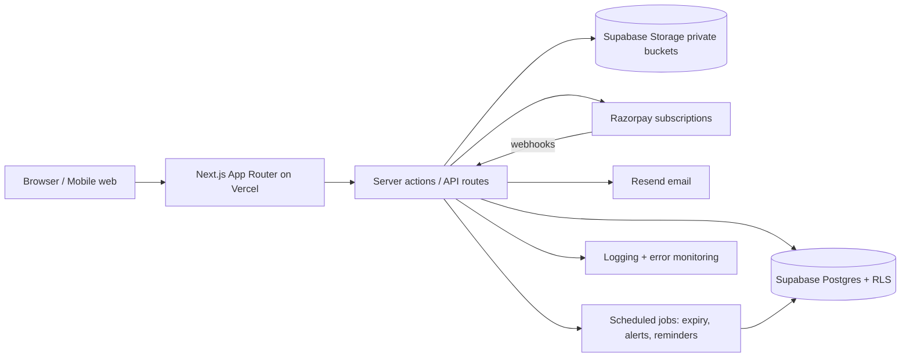

# Technical Architecture Document

## 4.1 Architecture Overview



## 4.2 Folder Structure (proposed)

```
app/
  (public)/            # home, explore, simulator, academy, plans, about, legal
  (member)/            # dashboard, properties full, forum, tools
  (admin)/admin/       # admin panel
  api/                 # route handlers
components/
  ui/                  # design system primitives
  property/ forum/ tools/ dashboard/ admin/
lib/
  auth/ entitlements/ projections/ validation/ payments/ notifications/ audit/
prisma/
  schema.prisma migrations/
jobs/                  # scheduled tasks
tests/                 # unit, integration, e2e
```

## 4.3 Stack and Third Parties

| Layer | Choice | Purpose |
|---|---|---|
| Frontend | Next.js App Router, TypeScript, Tailwind | SSR/SEO public pages, member app |
| Backend | Next.js route handlers + server actions | API + server-side authorisation |
| DB | Supabase Postgres | Primary data store, RLS |
| ORM | Prisma | Schema, migrations, typed access |
| Auth | Supabase Auth | Email/password, sessions, JWT |
| Storage | Supabase Storage (private) | Property photos, documents, inspection photos |
| Payments | Razorpay Subscriptions | Mandates, invoices, webhooks |
| Email | Resend | Transactional + alert emails |
| Hosting | Vercel | App hosting, cron |
| Monitoring | Sentry + Vercel logs + DB alerts | Errors, performance |
| Analytics | Vercel Analytics / Plausible | Funnel + metrics |

## 4.4 Auth and Entitlement Model

- JWT contains `sub`, `role` (`user`/`admin`), and is refreshed; tier is **not** trusted from JWT alone — resolved server-side from `subscriptions`.
- Entitlement resolver: `getEntitlement(userId) → { tier, active, expiresAt, isAdmin }`, cached ≤ 60s.
- All member checks call the resolver server-side.

## 4.5 Payments Flow

1. User selects plan → server creates/reuses Razorpay plan → creates subscription → returns `subscription_id`.
2. Client completes mandate via Razorpay Checkout.
3. Webhooks update `subscriptions` and `payments`; entitlement cache invalidated.
4. Invoice record created on `payment.captured` with GST breakdown.
5. Refund events recorded; no silent state changes.

## 4.6 Secrets and Environments

- `.env.local` (dev), Vercel env vars (preview/prod), Supabase project secrets.
- Required: `DATABASE_URL`, `SUPABASE_URL`, `SUPABASE_ANON_KEY`, `SUPABASE_SERVICE_ROLE_KEY`, `RAZORPAY_KEY_ID`, `RAZORPAY_KEY_SECRET`, `RAZORPAY_WEBHOOK_SECRET`, `RESEND_API_KEY`, `NEXT_PUBLIC_APP_URL`, `CRON_SECRET`.
- Service role key never shipped to client; only server runtime.

## 4.7 Staging and Production

- Environments: `local`, `preview` (per PR), `staging`, `production`.
- Separate Supabase projects and Razorpay test/live keys.
- Staging seeded with demo listings and test users.
- Migrations run via CI; production migrations require manual approval.

## 4.8 Security, Backup, Monitoring

- RLS everywhere; least privilege; signed URLs; CSRF protection on mutations; input sanitisation; rate limiting; audit log.
- Daily DB backups (30 days), storage versioning, quarterly restore test.
- Error monitoring with alert routing; slow query logging; webhook failure alerts; cron failure alerts.

---
