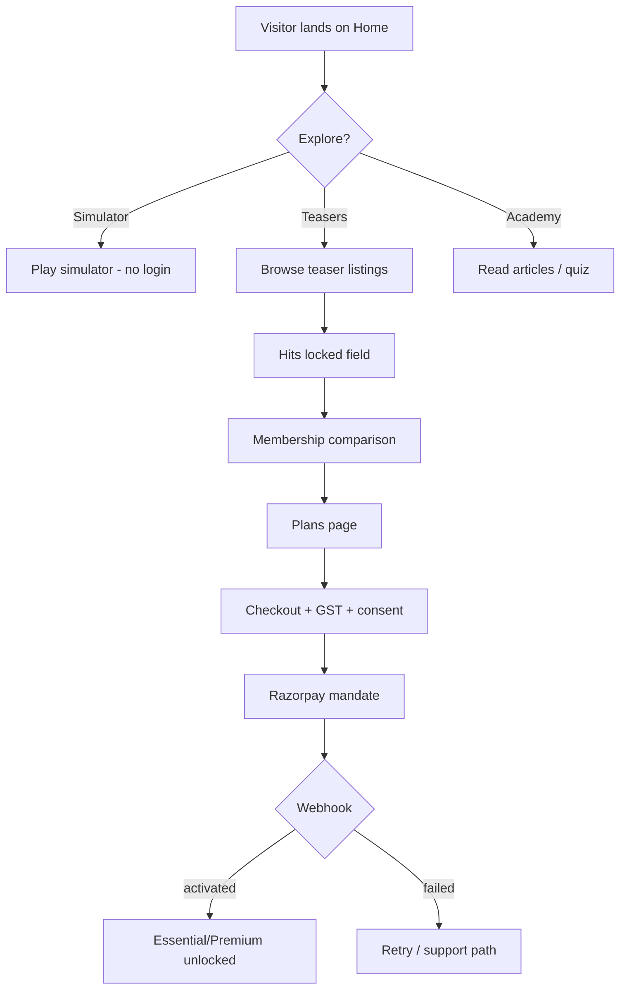
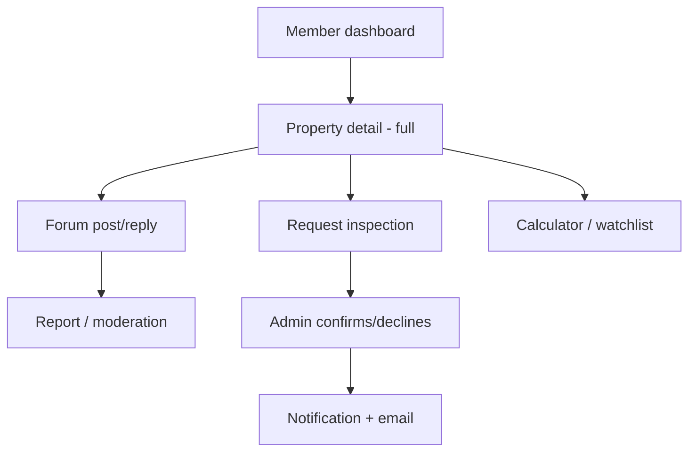
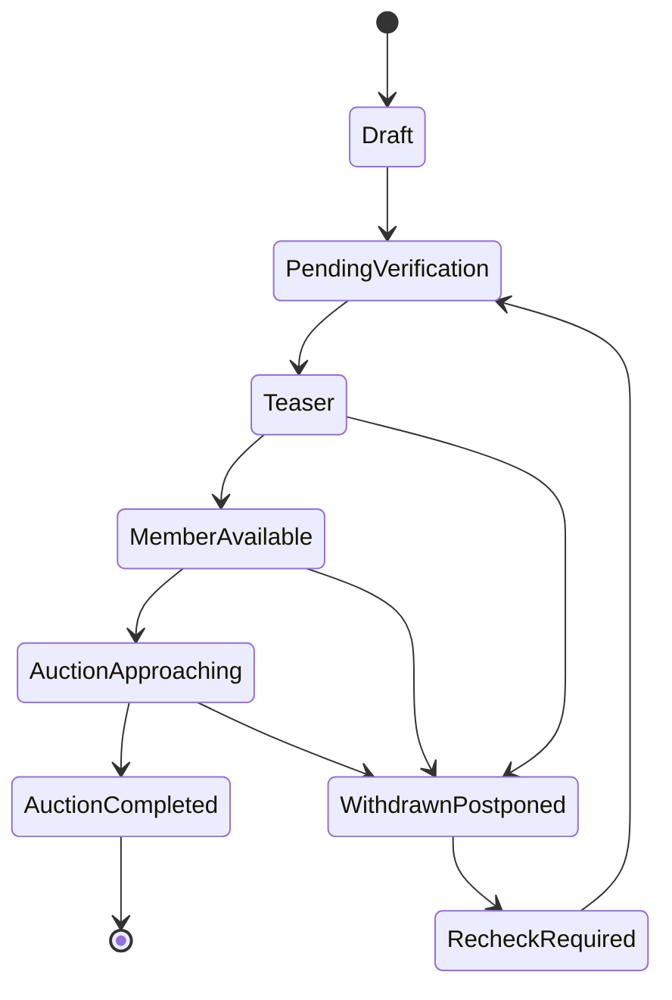

# Product Requirements Document (PRD)

## 1.1 Vision and Problem Statement

**Vision.** AuctionIQ is a premium bank-auction property intelligence platform that helps Indian investors *discover the opportunity, understand the risks, and prepare before they bid* — through free education and simulation, and paid verified information, community knowledge and due-diligence coordination.

**Problem.** Bank auction (SARFAESI/DRT) properties in South Mumbai and Navi Mumbai offer price advantages but are opaque: scattered notices, unclear dues, possession uncertainty, document gaps, and no structured peer knowledge. Investors either avoid the category or bid uninformed.

**Product principle.** Free users learn and practise. Paying members discover and evaluate real opportunities. Premium members receive deeper intelligence and defined support services.

**Initial market.** South Mumbai and Navi Mumbai, Maharashtra.

## 1.2 User Roles

| Role | Definition | Commercial state |
|---|---|---|
| Public visitor | Unauthenticated | Free |
| Registered free user | Has account, no active subscription | Free |
| Essential member | Active Essential subscription | ₹850/month + GST |
| Premium member | Active Premium subscription | ₹1,250/month + GST |
| Expired member | Subscription ended/cancelled | Read-only own records |
| Administrator | Operations team | Internal |

## 1.3 Feature List by Phase

### MVP (Phase 1 — Launch)

| # | Feature | Notes |
|---|---|---|
| F1 | Public teaser listings (list + detail) | Photos, reserve price, broad category, general area, generic ref |
| F2 | Membership plans and Razorpay subscription purchase | Auto-renewal mandates |
| F3 | Entitlement engine and expiry handling | Server-enforced |
| F4 | Admin listing management (CRUD + status workflow) | Manual entry |
| F5 | Free virtual auction simulator | 3 difficulty levels, 6 fictional properties |
| F6 | Learning Academy + 2 quizzes + gamification basics | 10 seeded articles, badges, progress |
| F7 | Property-specific discussion forum (paid) | Contribution types, upvotes, helpful answers, reports, moderation |
| F8 | Basic acquisition-cost calculator | Public basic mode; member standard mode; unknown-charge handling |
| F9 | Member dashboard, watchlists, standard alerts | Email + in-platform |
| F10 | Inspection request (logged) | Essential 5/month; Premium unlimited fair-use |
| F11 | Advocate coordination enquiry (Premium) | Request logged, admin workflow, fee disclosure |
| F12 | Policy pages, consent, access controls, audit log | ToS, Privacy, Community, Refund |

### Phase 2 — Premium Intelligence

| # | Feature |
|---|---|
| P1 | Property risk/intelligence dashboard with evidence labels |
| P2 | Property comparison (up to 3) |
| P3 | Maximum-bid planner |
| P4 | Advanced alerts (document availability, EMD deadlines, auction date changes) |
| P5 | Legal-review workspace and advocate credential verification |
| P6 | DRT case/application tracking dashboard |
| P7 | Full inspection workflow, checklist, observations, history |
| P8 | Investment exit planner (Premium) |

### Phase 3 — Deferred

| # | Feature | Condition |
|---|---|---|
| D1 | SmartDoor integration | Partner authorisation, API, commercial terms |
| D2 | Automated data ingestion | Approved sources and permissions only |
| D3 | Document extraction / structured parsing | — |
| D4 | Institutional/professional investor dashboard | — |
| D5 | WhatsApp/SMS alerts | Cost, consent, provider review |
| D6 | Real-time forum (websockets) | Near-real-time acceptable in MVP |

### Explicitly Out of Scope (all phases unless re-approved)

- Public sale-notice repository.
- Real bidding, deposits, or transactions of any kind.
- Any public contact route, WhatsApp link, or property enquiry for free users.
- Pooling investor funds or arranging collective investments.
- Presenting the platform as a bank, auction authority, or legal adviser.
- Labelling any property “legally safe” from an automated score.

## 1.4 User Stories with Acceptance Criteria

### Public / Free

**US-01 — Browse teaser listings**
As a public visitor I can browse teaser listings so I can see what opportunities exist.
- List shows property photos, reserve price, broad category, general area (e.g. “Mumbai”), generic reference (e.g. AQ-MUM-0042).
- Detail shows selected photos, reserve price, broad category, general area, generic reference, auction date if public-safe, and locked-field placeholders.
- Exact locality that would identify the property, building/society name, sale notice, bank contacts, and documents are not present in HTML, JSON, page source, or metadata.
- Attempting `/properties/:id` for a member-only field returns no data server-side.
- Locked fields render a membership comparison CTA — **no** contact shortcut, WhatsApp link, or enquiry form.

**US-02 — Use simulator without paying**
As a public visitor I can run the full simulator and see results.
- No login required for simulator.
- All three difficulties available.
- Budget ceiling enforced; over-budget bid rejected with explanation.
- Post-game report shows decisions, virtual cost breakdown, and a clear “educational only, no real bids” notice.
- Simulation history persists for logged-in users; anonymous sessions may store locally.

**US-03 — Access learning content**
As a public visitor I can read articles, take quizzes, and earn badges.
- All Academy articles readable without login.
- Quiz results and badges stored for logged-in users only; anonymous users get ephemeral results with sign-up prompt (non-blocking).

**US-04 — View plans and purchase**
As a visitor I can compare plans and subscribe.
- Plans page shows Essential vs Premium feature matrix with exact inclusions and exclusions.
- Advocate fee disclosure (platform coordination vs advocate fees) visible **before** payment.
- Checkout shows price + 18% GST breakdown.
- Unchecked consent required for auto-renewal mandate.
- Successful payment grants tier immediately via webhook; failed payment shows recovery path.

### Essential Member

**US-05 — Unlock listing details**
As an Essential member I can view exact location, building/society name, and member documents.
- Exact location, building/society name, and member-accessible documents visible.
- Sale notices never shown publicly; shown privately only where authorised.
- Downloading a document issues a short-lived signed URL; URL is not indexable and expires.
- Direct API access to another property’s documents without entitlement returns 403.

**US-06 — Post in property forum**
As an Essential member I can discuss a specific property.
- Post requires a contribution type from the defined enum.
- Replies, upvotes, helpful-answer marking work.
- Posts visible only to members with access to that property.
- Report action available; reported post enters admin queue.
- Edit history and timestamps visible.

**US-07 — Request inspection (Essential)**
As an Essential member I can request up to five inspections per month.
- Sixth request in a calendar month is blocked with clear message and counter.
- Request captures property, preferred dates, user details, consent checkbox.
- Status tracked: requested → confirmed/declined → completed/cancelled.
- Confirmation email and in-platform notification sent.

**US-08 — Use calculator and watchlist**
- Standard calculator includes stamp duty, registration, legal, dues, repairs, financing, possession costs.
- Unknown dues display as “Unknown,” never as zero.
- Assumptions panel is always visible/expandable.
- Watchlist add/remove works; alerts for followed properties delivered by email + in-platform.

### Premium Member

**US-09 — Premium entitlements**
- All Essential features included.
- Unlimited inspection requests subject to fair-use flag (rate-limit guard, e.g. >10/month flags for review, does not hard-block).
- Advocate coordination enquiry available with fee disclosure.
- Premium investor sessions listed where scheduled.
- Phase 2 items show as “available soon” only if explicitly labelled; never presented as live.

### Expired Member

**US-10 — Expiry handling**
- On expiry: restricted property fields, documents, forum posting, inspection requests, and calculations for new properties are disabled.
- User retains: account details, payment history, own forum posts (read-only), own inspection history, own saved calculations, membership status.
- Re-subscription restores access without data loss.

### Administrator

**US-11 — Manage listings**
- Create, edit, publish as teaser, move to member-available, withdraw/postpone, mark recheck-required, mark completed.
- Status transitions recorded in history with actor and timestamp.
- Publishing requires all mandatory public fields and at least one public photo.

**US-12 — Moderate forum**
- View reports queue; remove post, warn user, dismiss report, record reason.
- Removed content hidden from members but retained in audit log.
- Appeal workflow: user can appeal; admin records outcome.

**US-13 — Manage subscriptions and access**
- View user subscription state, payment history, grant/revoke access with audit reason.
- Manual grant creates an audited record and does not alter Razorpay state silently.

**US-14 — Manage inspections and advocate enquiries**
- Update inspection status; add internal notes; notify member on status change.
- Advocate enquiry: record request, assign status, disclose fees, never mark “advocate-reviewed” without a real review record.

## 1.5 User Flows (major journeys)

## 1.6 Non-Functional Requirements

| Area | Requirement |
|---|---|
| Performance | LCP < 2.5s on 4G mobile for public pages; teaser list API p95 < 400ms; simulator interaction < 100ms client-side |
| Security | Server-side authorisation on every restricted read; signed URLs for documents; no restricted fields in public API/source/sitemap/cache; rate limiting on auth, forum, inspection, checkout |
| SEO | Public pages indexable; member pages `noindex`; no restricted data in meta/JSON-LD; canonical tags; sitemap excludes member routes |
| Accessibility | WCAG 2.1 AA target: contrast, keyboard nav, focus states, form labels, alt text |
| Mobile | Mobile-first; tested at 360px, 390px, 768px, 1024px, 1440px |
| Backups | Daily automated DB backups, 30-day retention; storage versioning for documents |
| Logging | Structured app logs; audit log for admin and access-sensitive actions; error monitoring with alerting |
| Privacy | DPDP-aligned consent, retention schedule, deletion workflow, grievance contact |
| Availability | 99.5% target MVP; status page optional |

## 1.7 Success Metrics

- Public visitors, simulator starts/completions, Academy completion rate.
- Teaser views → plan views → checkout starts → paid conversions.
- Free-to-paid conversion; Essential→Premium upgrades.
- MRR, retention, cancellations, churn reason.
- Forum participation, helpful answers per active member.
- Inspection requests and completion rate.
- Legal/advocate enquiry volume (Premium).
- Cost per acquired paid member.

---
