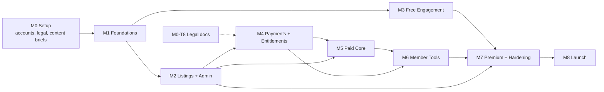

# AuctionIQ — Project Plan v1.2

**Status:** Product documentation approved; implementation plan submitted for review. A1–A16 are approved.
**Build status:** No milestone implementation has started; explicit build authorization remains pending.

## Implementation Plan (M0–M8)

**Status:** v1.2 — approved documentation and delivery plan.
**Build gate:** No code is written until you issue explicit build authorization (see §10). M0 below is setup, not coding.

---

## 0. Approval Status

| Item | Status |
|---|---|
| PRD, Functional Spec, Access Matrix, Architecture, Schema, API, Wireframes, Test Plan, Project Plan | ✅ Approved |
| Implementation plan (this document) | For your review |
| Build authorization | ⏳ Pending your explicit go-ahead |
| Phase 2 (P1–P8) planning | Separate engagement, not in this plan |

---

## 1. M0 — Pre-Build Setup

Most projects fail here, not in code. These tasks run in parallel and must close before their dependent milestones.

| ID | Task | Owner | Exit criteria | Blocks |
|---|---|---|---|---|
| M0-T1 | Confirm legal entity, GSTIN, registered address, grievance officer | Founder | Details available for invoices and policy pages | M4, M7 |
| M0-T2 | Razorpay account, KYC, subscription capability confirmation | Founder | Test keys issued; subscriptions enabled on account | M4 |
| M0-T3 | Supabase org with three projects (dev, staging, prod), region `ap-south-1` | Dev | Connection strings issued | M1 |
| M0-T4 | Vercel team, staging and production projects, domains | Dev | Staging URL live | M1 |
| M0-T5 | Resend account, domain verification (SPF/DKIM/DMARC) | Dev | Test email delivers to inbox | M4, M6 |
| M0-T6 | Sentry project + alert routing | Dev | Test error captured and alerted | M1 |
| M0-T7 | Repo creation, branch protection, PR template, CI skeleton | Dev | `main` protected; CI required on PR | M1 |
| M0-T8 | Legal docs drafted: ToS, Privacy, Refund, Community Guidelines, consent notices | Founder + counsel | Drafts ready for review | M4 live checkout |
| M0-T9 | Brand assets: logo, favicon, OG template | Founder/designer | Files delivered or placeholder approved in writing | M1 |
| M0-T10 | Content briefs: 8 listings, 6 simulator scenarios, 10 articles, 2 quizzes | PM/content owner | Briefs approved | M2, M3 |
| M0-T11 | Environment variable register (names, owners, rotation dates) | Dev | Register created and shared | M1 |
| M0-T12 | Milestone payment schedule and contract signed | Founder + dev | Signed | M1 |

**M0 exit:** all accounts in test mode, repo protected, content briefs approved, legal drafting underway, contract signed.

> **Critical note on M0-T8:** legal documents block *live checkout*, not development. Drafting must start now so M4 isn't delayed. If drafts aren't ready by M4, checkout stays in test mode and launch slips — not the build.

---

## 2. Engineering Conventions

| Area | Decision |
|---|---|
| Repo | Single Next.js app (no monorepo/turborepo at this scale): `app/`, `components/`, `lib/`, `prisma/`, `jobs/`, `tests/` |
| Branching | Trunk-based; short-lived feature branches; PR required; squash merge |
| Migrations | Prisma Migrate, forward-only; staging auto, production manual-approve |
| Environments | `local` → `preview` (per PR) → `staging` → `production`; separate Supabase projects and Razorpay test/live keys |
| Secrets | Vercel env vars only; service-role key server-only; nothing sensitive under `NEXT_PUBLIC_` |
| CI | Lint, typecheck, `prisma validate`, unit tests, build, preview deploy |
| Review | 1 reviewer minimum; **2 reviewers** for `lib/auth`, `lib/projections`, `lib/payments`, RLS files |
| Feature flags | Simple config flags so Phase 2 items are hidden or clearly labelled "coming soon" — never presented as live |
| Definition of Done | Code + tests + staging demo + docs updated + leak check + a11y check (UI) + acceptance criteria met |
| Cadence | 2-week sprints; demo at sprint end; milestone gate = sprint boundary |

---

## 3. Milestone Work Breakdown

### M1 — Foundations

| ID | Task | Depends on | Exit criteria |
|---|---|---|---|
| M1-T1 | Init Next.js + TS + Tailwind, base config | M0-T7 | Builds, lints, deploys |
| M1-T2 | Prisma schema v1 (all MVP tables + enums) | M1-T1 | `prisma validate` + migration on staging |
| M1-T3 | Supabase Auth (signup, login, reset, session) | M1-T1 | All flows pass on staging |
| M1-T4 | Profile sync trigger (`auth.users` → `profiles`) | M1-T3 | Signup creates profile row |
| M1-T5 | Entitlement resolver + short cache | M1-T2 | Unit tests cover all tier/expiry states |
| M1-T6 | Server-side role and route guards | M1-T5 | Guard tests pass |
| M1-T7 | Design tokens + UI primitives (button, input, card, badge, table, modal, toast) | M1-T1 | Component demo page |
| M1-T8 | Public layout shell, nav, footer, legal placeholders | M1-T7 | Responsive at 360/768/1440 |
| M1-T9 | RLS policies v1 (properties, documents, forum, inspections, payments) | M1-T2 | Policy tests pass |
| M1-T10 | CI pipeline + staging deploy | M1-T1 | Green pipeline, staging URL |
| M1-T11 | Audit log utility + write hooks | M1-T2 | Admin action recorded with actor/timestamp |
| M1-T12 | Error monitoring and structured logging | M0-T6 | Test error visible with request ID |

**Gate:** staging live; auth working; entitlement resolver tested; RLS drafted and tested; primitives demoed.

### M2 — Listings and Admin

Admin auth gate; property CRUD; photo upload with `is_public` flag; document upload to private bucket; status workflow with history; public teaser list/detail via per-role projection; search and filters; sitemap/robots excluding member routes; admin listing UI; seed script for 8 demo listings.

**Gate:** admin can move a listing Draft → Teaser → Member-available; public projection leak tests **L1, L5, L6** pass; seed data on staging.

### M3 — Free Engagement (parallel to M2/M4)

Simulator engine (scenarios, bid increments, timer, budget enforcement, outcome report); simulator UI across 3 difficulties; simulation history; Academy content model + reading UI; quiz engine + scoring; badges and progress; seeded 10 articles and 2 quizzes.

**Gate:** full simulator playable without login; quiz flows and badges work; mobile tested; persistent "educational only" banner verified.

### M4 — Payments and Entitlements

Razorpay plan/subscription creation; checkout UI with price + 18% GST breakdown and unchecked auto-renew consent; webhook handler (signature verification, idempotency by event id); invoice records with GST; entitlement activation; expiry cron with 3-day grace; cancellation flow; payment emails; failure-recovery UI; refund recording; manual admin grant/revoke with audit; full payment test suite.

**Gate:** end-to-end payment tests pass in test mode; expiry job verified; invoices correct (validated with CA); consent captured; **legal pages published** before live keys.

### M5 — Paid Core

Member property detail projection; document signed-URL flow with access logging; forum model + UI (contribution types, votes, helpful answers, edit history, follows, reports); moderation queue + actions + audit; reply notifications; badge integration.

**Gate:** forum restricted to paid members; moderation works with audit trail; document URLs expire and access is logged; leak tests **L3, L4, L7** pass.

### M6 — Member Tools

Acquisition-cost calculator (public basic vs member standard, unknown-charge handling, assumptions panel); max-bid planner hidden behind Phase 2 flag; watchlist + alert engine (email + in-app); notification centre; dashboard aggregation; inspection request flow with server-enforced quota and status lifecycle; admin inspection management.

**Gate:** calculator produces documented test-case results consistently; quota enforced server-side; alerts delivered; dashboard shows all modules correctly per tier.

### M7 — Premium Enquiry, Policies, Hardening

Advocate enquiry form with fee disclosure + admin workflow; Premium fair-use flagging; premium sessions static listing; all policy pages published and versioned; consent notices at each collection point; data export/delete request flow; security headers; rate limiting; accessibility pass; performance pass; backup/restore drill; **full leak suite in production config**; admin guide draft.

**Gate:** all 15 launch acceptance criteria pass on staging; no Phase 2 item presented as live; admin guide reviewed.

### M8 — Launch

Production provisioning; DNS; live Razorpay keys; monitoring alerts live; launch checklist executed; handover (source, docs, admin guide, credentials); post-launch monitoring window; defect warranty terms confirmed.

**Gate:** signed launch acceptance; credentials transferred securely; support runbook agreed.

---

## 4. Critical Path

**Critical path:** M0 → M1 → M2 → M4 → M5 → M6 → M7 → M8.
**Parallel tracks:** M3 (free engagement) runs alongside M2/M4; content seeding runs throughout; legal drafting runs from M0 to M4.

The two schedule risks are **M0-T2 (Razorpay approval)** and **M0-T8 (legal drafts)** — both external, both gating M4.

---

## 5. Test and Release Gates

Every milestone closes only when:

| Gate | Requirement |
|---|---|
| Unit | Entitlement resolver, projections, calculator, quota logic, simulator rules covered |
| Integration | API routes tested with each role |
| Leak suite | L1–L10 pass in that milestone's scope; **full suite** in M7 against production config |
| E2E smoke | Signup → browse teaser → subscribe (test) → member detail → forum → inspection |
| Accessibility | Keyboard nav, focus states, contrast on all new UI |
| Demo | Staging walkthrough against acceptance criteria |
| Docs | Feature behaviour + admin steps updated |

Release to production requires the full checklist in Doc 8 §8.7 plus the pre-production checklist in Doc 9 §9.4.

---

## 6. Risk Register

| Risk | Likelihood | Impact | Trigger | Mitigation |
|---|---|---|---|---|
| **Development budget (₹1.4L) vs MVP scope** | High | High | Vendor quotes exceed allocation | See budget note below |
| Razorpay subscription approval delay | Medium | High | No test keys by end of M0 | Start M0-T2 immediately; fallback: monthly one-time payments with manual renewal (requires doc change) |
| Legal documents delay live checkout | Medium | High | Drafts not ready by M4 | Start M0-T8 now; keep checkout in test mode; block launch, not build |
| Data-leak regression | Medium | Critical | Any leak test fails | Leak suite in CI on every PR touching projections/auth; 2-reviewer rule |
| Scope creep into Phase 2 | High | Medium | New feature requests | Change control: every new item goes to Phase 2 list with separate quote |
| Content not ready for M3 | Medium | Low | Briefs unapproved by M1 | Ship clearly labelled sample content |
| Single-developer bus factor | Medium | High | Dev unavailable | Repo docs, credential escrow, weekly demos, source ownership clause |
| GST/invoice correctness | Low | Medium | Invoice mismatch | Validate invoice format with a CA before M4 gate |

### Budget reality check (important)

Indicative effort for M1–M8 at this scope is roughly **54–69 person-days**. Against the ₹1,40,000 development allocation, that implies an effective rate of about ₹2,000–2,600/day — below prevailing Indian market rates for senior full-stack work (typically ₹4,000–8,000/day). Realistically this means one of:

1. **A mid-level developer or small team on a longer timeline** — acceptable if quality gates hold.
2. **Scope trimming** — e.g. launch with M1–M5 + M7 essentials, move most of M6 (calculator standard mode, alerts engine) to a fast-follow release.
3. **Reallocating from the protected reserve** — only as a conscious, documented decision, not by drift.

My recommendation is option 2 unless vendor quotes come in comfortably within budget. The launch acceptance criteria in the spec can still be met with reduced seeded content and a simplified M6, but the M6 tools are core paid value — so decide this *before* signing the vendor contract, not during M6.

---

## 7. Approval Register

The following table is the authoritative approval register for this v1.2 pack. A1–A16 are approved.

| ID | Decision | Approved outcome | Status |
|---|---|---|---|
| A1 | Working title and brand placeholder | AuctionIQ is the working title; use provided brand assets or an approved placeholder. | Approved |
| A2 | Technology stack | Next.js App Router, TypeScript, Tailwind, Supabase Postgres/Auth/Storage, Prisma, Razorpay, Resend, and Vercel. | Approved |
| A3 | Launch tiers and MVP boundaries | Essential and Premium launch together; inspections are logged requests; advocate coordination is enquiry-only; DRT workspace is Phase 2. | Approved |
| A4 | Billing and tax presentation | Auto-renewal mandates, no trial, no partial-month refunds; prices are exclusive of 18% GST and GST is shown at checkout. | Approved |
| A5 | Seed content | Eight demo listings, six fictional simulator properties, ten Academy articles, and two quizzes. | Approved |
| A6 | Notifications | Email and in-platform notifications only for MVP. | Approved |
| A7 | Access boundaries | No public property enquiry/contact route; restricted property data is available only to entitled members and administrators. | Approved |
| A8 | Schema and API security rules | Per-role projections; restricted keys absent from free/public responses; server-side entitlement checks. | Approved |
| A9 | Deferred scope | Phase 2/3 features remain deferred and must not be represented as live. | Approved |
| A10 | Milestone gates | Milestones use demonstrable exit criteria and payment gates; full launch acceptance is required before production. | Approved |
| A11 | Delivery schedule and ownership | Use the M0–M8 work breakdown, task owners, dependencies, exit criteria, and critical path in ProjectPlan.md. | Approved |
| A12 | Inspection request semantics | MVP inspection is a logged request only. Admin status updates record request handling and do not imply that an inspection has been arranged or completed by AuctionIQ. | Approved |
| A13 | Member property contact | Paid-member property contact is a request to AuctionIQ support only; it must not expose bank/seller contact details or create a direct contact route. | Approved |
| A14 | Cancellation and refund handling | Cancellation takes effect at the end of the paid period; access remains through that period. No partial-month refunds; any other refund follows the published Refund Policy and is audited. | Approved |
| A15 | Listing source and verification | A listing must have a recorded source and verification timestamp before publication. Admins recheck when auction details change and record status transitions; no unapproved automated ingestion. | Approved |
| A16 | RLS and payment event records | Every user-accessible table has an explicit RLS policy. Payment processing stores webhook event IDs for idempotency and records invoice data; service-role access remains server-only. | Approved |

## 8. Handover and Launch Runbook (summary)

- Deliverables per spec §19: architecture, wireframes, schema/permission design, staging, test report, security test results, production deployment, source code with ownership rights, admin guide, maintenance and hosting quote, third-party recurring costs, timeline and payment schedule, exclusions list.
- Credentials transferred via password manager share (not email/chat).
- 30-day post-launch defect warranty defined in contract.
- Monitoring alerts routed to a named owner with an escalation path.

---

## 9. Change Control

Any request not in the approved pack is logged as a change with: description, phase impact, effort estimate, cost, and schedule effect. Changes are approved in writing before work starts. This protects both the budget and the launch date.

---

## 10. What I Need From You

To begin M0, I need:

1. **Company details** — legal name, GSTIN, registered address, grievance officer name and email.
2. **Razorpay** — confirm you will start KYC and subscription approval this week.
3. **Brand** — logo/favicon files, or written confirmation to use placeholders.
4. **Content owner** — named person responsible for M0-T10 briefs.
5. **Vendor decision** — in-house, agency, or freelancer (affects whether this plan is a build guide or a vendor brief).
6. **Budget decision** — pick option 1, 2, or 3 from §6 before signing any development contract.

---
## 11. Pre-Production Checklist

- All 15 launch acceptance criteria pass.
- Leak tests pass in production configuration.
- Legal pages are published and versioned; grievance contact is live.
- Backups and restore are tested; monitoring and alerts are live.
- Admin guide and credentials are handed over securely.
- No mock integrations are presented as live.
- SmartDoor, DRT, and other Phase 2/3 items are hidden or clearly labelled “coming soon.”
