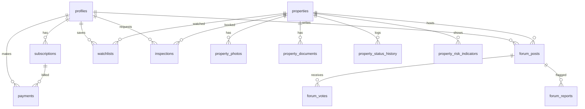

# Database Schema and Data Dictionary

## §5.1 — Enums (complete, no placeholders)

- user_role: user | admin
- subscription_tier: essential | premium
- subscription_status: pending | active | past_due | cancelled | expired
- payment_status: created | authorized | captured | failed | refunded
- property_type: residential_flat | residential_house | commercial | plot | other
- listing_status: draft | pending_verification | teaser | member_available |
  auction_approaching | auction_completed | withdrawn_postponed | recheck_required
- possession_status: vacant | occupied | third_party | unknown
- evidence_label: verified_source | advocate_reviewed | first_hand |
  third_party | pending_verification | unknown
- risk_indicator: price_attractiveness | document_completeness | possession |
  dues | inspection | legal_questions | data_freshness
- contribution_type: inspection_experience | document_question |
  reported_dues | building_condition | valuation | auction_process |
  advocate_question | other
- inspection_status: requested | confirmed | completed | cancelled | declined
- simulation_difficulty: beginner | intermediate | advanced
- report_status: open | resolved | dismissed
- source_type: sarfaesi_notice | drt_order | bank_website | auction_portal |
  public_notice | direct_intake | other
- notification_type: account_created | email_verified | password_reset |
  payment_succeeded | payment_failed | subscription_renewing_soon |
  subscription_cancelled | subscription_expired | new_matching_listing |
  auction_date_changed | emd_deadline_approaching | new_document_available |
  forum_reply | forum_followed_thread | inspection_status_changed |
  inspection_reminder | enquiry_response | advocate_enquiry_status |
  report_outcome | listing_recheck_flagged

## §5.2 — Tables (fully typed)

Conventions applied:
- All PK: `id uuid primary key default gen_random_uuid()`.
- All FKs: `ON DELETE RESTRICT` unless otherwise stated.
- All money: `bigint` (whole INR, no paise).
- All timestamps: `timestamptz`.

### profiles
- id             uuid PK                            -- = auth.users.id
- full_name      text not null
- phone          text null
- role           user_role not null default 'user'
- gstin          text null
- created_at     timestamptz not null default now()
- updated_at     timestamptz not null default now()
- deleted_at     timestamptz null

### subscriptions
- id                      uuid PK
- user_id                 uuid not null FK profiles(id)
- tier                    subscription_tier not null
- status                  subscription_status not null
- razorpay_subscription_id text unique not null
- current_period_start    timestamptz not null
- current_period_end      timestamptz not null
- auto_renew              boolean not null default true
- cancelled_at            timestamptz null
- created_at              timestamptz not null default now()
- updated_at              timestamptz not null default now()
Index: (user_id, status)

### payments
- id                  uuid PK
- user_id             uuid not null FK profiles(id)
- subscription_id     uuid null FK subscriptions(id)
- razorpay_payment_id text unique not null
- razorpay_order_id   text null
- amount_inr          bigint not null
- gst_amount_inr      bigint not null
- currency            text not null default 'INR'
- status              payment_status not null
- invoice_number      text unique null
- method              text null
- created_at          timestamptz not null default now()

### properties
- id                       uuid PK
- reference_code           text unique not null
- title                    text not null
- property_type            property_type not null
- configuration            text null
- description              text null
- carpet_area_sqft         numeric(10,2) null
- built_up_area_sqft       numeric(10,2) null
- reserve_price_inr        bigint not null
- emd_amount_inr           bigint null
- emd_deadline             timestamptz null
- auction_date             date null
- auction_time             time null
- auction_authority        text null
- official_source_ref      text null
- source_type              source_type null
- source_reference         text null
- source_captured_at       timestamptz null
- verified_by              uuid null FK profiles(id)
- last_verified_at         timestamptz null
- recheck_due_at           timestamptz null
- second_reviewer_id       uuid null FK profiles(id)
- general_location         text not null
- exact_location           text null       -- restricted
- building_name            text null       -- restricted
- society_name             text null       -- restricted
- possession_status        possession_status not null default 'unknown'
- possession_source        text null
- reported_dues_inr        bigint null
- dues_verification_status evidence_label not null default 'unknown'
- inspection_available     boolean not null default false
- listing_status           listing_status not null default 'draft'
- published_at             timestamptz null
- created_by               uuid not null FK profiles(id)
- created_at               timestamptz not null default now()
- updated_at               timestamptz not null default now()
- deleted_at               timestamptz null
Index: (listing_status, auction_date), (general_location), (recheck_due_at)

### property_photos
- id           uuid PK
- property_id  uuid not null FK properties(id) ON DELETE CASCADE
- storage_path text not null
- caption      text null
- sort_order   integer not null default 0
- is_public    boolean not null default true
- created_at   timestamptz not null default now()
Index: (property_id, sort_order)

### property_documents
- id                   uuid PK
- property_id          uuid not null FK properties(id) ON DELETE CASCADE
- doc_type             text not null
- storage_path         text not null
- is_member_accessible boolean not null default true
- uploaded_by          uuid not null FK profiles(id)
- created_at           timestamptz not null default now()
Index: (property_id)

### property_status_history
- id           uuid PK
- property_id  uuid not null FK properties(id) ON DELETE CASCADE
- from_status  listing_status not null
- to_status    listing_status not null
- changed_by   uuid not null FK profiles(id)
- note         text null
- created_at   timestamptz not null default now()

### property_risk_indicators
- id             uuid PK
- property_id    uuid not null FK properties(id) ON DELETE CASCADE
- indicator      risk_indicator not null
- evidence_label evidence_label not null
- value_text     text null
- note           text null
- updated_by     uuid not null FK profiles(id)
- updated_at     timestamptz not null default now()
Unique: (property_id, indicator)

### forum_posts
- id                uuid PK
- property_id       uuid not null FK properties(id) ON DELETE CASCADE
- author_id         uuid not null FK profiles(id)
- parent_id         uuid null FK forum_posts(id) ON DELETE CASCADE
- contribution_type contribution_type not null
- body              text not null
- is_helpful_answer boolean not null default false
- upvote_count      integer not null default 0
- created_at        timestamptz not null default now()
- edited_at         timestamptz null
- deleted_at        timestamptz null
Index: (property_id, created_at), (author_id)

### forum_votes
- id         uuid PK
- post_id    uuid not null FK forum_posts(id) ON DELETE CASCADE
- user_id    uuid not null FK profiles(id)
- created_at timestamptz not null default now()
Unique: (post_id, user_id)

### forum_follows
- id          uuid PK
- user_id     uuid not null FK profiles(id)
- property_id uuid not null FK properties(id) ON DELETE CASCADE
- created_at  timestamptz not null default now()
Unique: (user_id, property_id)

### forum_reports
- id              uuid PK
- post_id         uuid not null FK forum_posts(id) ON DELETE CASCADE
- reporter_id     uuid not null FK profiles(id)
- reason          text not null
- status          report_status not null default 'open'
- resolved_by     uuid null FK profiles(id)
- resolved_at     timestamptz null
- resolution_note text null
- created_at      timestamptz not null default now()
Index: (status, created_at)

### watchlists
- id          uuid PK
- user_id     uuid not null FK profiles(id)
- property_id uuid not null FK properties(id) ON DELETE CASCADE
- created_at  timestamptz not null default now()
Unique: (user_id, property_id)

### inspections
- id              uuid PK
- property_id     uuid not null FK properties(id)
- user_id         uuid not null FK profiles(id)
- preferred_dates jsonb not null          -- ISO date strings, 1..3 entries
- status          inspection_status not null default 'requested'
- confirmed_date  timestamptz null
- notes           text null
- admin_note      text null
- consent_at      timestamptz not null
- created_at      timestamptz not null default now()
- updated_at      timestamptz not null default now()
Index: (user_id, created_at), (property_id), (status)

### advocate_enquiries
- id             uuid PK
- user_id        uuid not null FK profiles(id)
- property_id    uuid not null FK properties(id)
- question       text not null
- status         text not null default 'received'
                 -- received | information_requested | assigned | closed
- fee_disclosure jsonb not null
- consent_at     timestamptz not null
- created_at     timestamptz not null default now()
- updated_at     timestamptz not null default now()
Index: (user_id, created_at), (status)

### notifications
- id         uuid PK
- user_id    uuid not null FK profiles(id)
- type       notification_type not null
- title      text not null
- body       text not null
- link       text null
- read_at    timestamptz null
- created_at timestamptz not null default now()
Index: (user_id, read_at), (user_id, created_at)

### simulation_sessions
- id            uuid PK
- user_id       uuid null FK profiles(id)
- session_id    text null
- scenario_key  text not null
- difficulty    simulation_difficulty not null
- budget_inr    bigint not null
- outcome       text not null          -- won | lost | abandoned
- final_bid_inr bigint null
- report        jsonb not null default '{}'::jsonb
- created_at    timestamptz not null default now()
Index: (user_id, created_at), (session_id)

### cost_calculations
- id          uuid PK
- user_id     uuid null FK profiles(id)
- property_id uuid null FK properties(id)
- inputs      jsonb not null
- outputs     jsonb not null
- created_at  timestamptz not null default now()
Index: (user_id, created_at)

### articles
- id                     uuid PK
- slug                   text unique not null
- title                  text not null
- summary                text not null
- body_markdown          text not null
- hero_image_path        text null
- category               text not null
- difficulty_level       text null    -- beginner | intermediate | advanced
- estimated_read_minutes integer not null default 5
- published_at           timestamptz null
- created_by             uuid not null FK profiles(id)
- created_at             timestamptz not null default now()
- updated_at             timestamptz not null default now()
- deleted_at             timestamptz null
Index: (slug), (published_at)

### quizzes
- id                uuid PK
- slug              text unique not null
- title             text not null
- description       text not null
- passing_score     integer not null default 70   -- 0..100
- related_article_id uuid null FK articles(id)
- is_published      boolean not null default false
- created_by        uuid not null FK profiles(id)
- created_at        timestamptz not null default now()
- updated_at        timestamptz not null default now()
- deleted_at        timestamptz null

### quiz_questions
- id                 uuid PK
- quiz_id            uuid not null FK quizzes(id) ON DELETE CASCADE
- question_text      text not null
- options            jsonb not null       -- [{key,text},...]
- correct_option_key text not null
- explanation        text null
- sort_order         integer not null default 0
- created_at         timestamptz not null default now()
Index: (quiz_id, sort_order)

### quiz_attempts
- id           uuid PK
- quiz_id      uuid not null FK quizzes(id)
- user_id      uuid null FK profiles(id)    -- null = anonymous
- session_id   text null
- score        integer not null
- passed       boolean not null
- answers      jsonb not null               -- [{question_id,chosen_key,correct}]
- started_at   timestamptz not null
- completed_at timestamptz not null
Index: (user_id, quiz_id), (session_id)

### badges
- id          uuid PK
- code        text unique not null
- name        text not null
- description text not null
- icon_key    text not null
- criteria    jsonb not null
- is_active   boolean not null default true
- created_at  timestamptz not null default now()

### user_badges
- id          uuid PK
- user_id     uuid not null FK profiles(id)
- badge_id    uuid not null FK badges(id)
- awarded_at  timestamptz not null default now()
Unique: (user_id, badge_id)
Index: (user_id, awarded_at)

### learning_progress
- id             uuid PK
- user_id        uuid not null FK profiles(id)
- article_id     uuid null FK articles(id)
- quiz_id        uuid null FK quizzes(id)
- progress_pct   integer not null default 0     -- 0..100
- last_viewed_at timestamptz not null default now()
- completed_at   timestamptz null
Check: (article_id IS NOT NULL) <> (quiz_id IS NOT NULL)
Unique: (user_id, article_id), (user_id, quiz_id)

### property_enquiries
- id                uuid PK
- property_id       uuid not null FK properties(id)
- user_id           uuid not null FK profiles(id)
- subject           text not null
- status            text not null default 'open'
                    -- open | awaiting_member | resolved | closed
- assigned_admin_id uuid null FK profiles(id)
- opened_at         timestamptz not null default now()
- closed_at         timestamptz null
Index: (property_id, user_id), (status)

### property_enquiry_messages
- id          uuid PK
- enquiry_id  uuid not null FK property_enquiries(id) ON DELETE CASCADE
- author_id   uuid not null FK profiles(id)
- author_role text not null        -- member | admin
- body        text not null
- created_at  timestamptz not null default now()
Index: (enquiry_id, created_at)

### invoices
- id                uuid PK
- invoice_number    text unique not null    -- 'AIQ/{FY}/NNNNN'
- user_id           uuid not null FK profiles(id)
- subscription_id   uuid not null FK subscriptions(id)
- payment_id        uuid not null FK payments(id)
- gstin             text null
- customer_gstin    text null
- place_of_supply   text not null
- taxable_value_inr bigint not null
- gst_rate          numeric(5,2) not null
- gst_amount_inr    bigint not null
- total_amount_inr  bigint not null
- description       text not null
- issued_at         timestamptz not null default now()
- pdf_path          text not null
- status            text not null default 'issued'   -- issued | void
- void_reason       text null
- created_at        timestamptz not null default now()
Index: (user_id, issued_at), (invoice_number), (payment_id)

### webhook_events
- razorpay_event_id text PK
- event_type        text not null
- payload_hash      text not null
- received_at       timestamptz not null default now()
- processed_at      timestamptz null
- status            text not null default 'received'
                    -- received | processed | failed
- error             text null
Index: (status, received_at)

### refunds
- id                uuid PK
- payment_id        uuid not null FK payments(id)
- user_id           uuid not null FK profiles(id)
- razorpay_refund_id text unique null
- amount_inr        bigint not null
- reason            text not null
- status            text not null default 'requested'
                    -- requested | approved | rejected | processed | failed
- requested_by      uuid not null FK profiles(id)
- approved_by       uuid null FK profiles(id)
- created_at        timestamptz not null default now()
- processed_at      timestamptz null
Index: (user_id, created_at), (status)

### audit_logs
- id          uuid PK
- actor_id    uuid null FK profiles(id)     -- null = system
- actor_role  text null
- action      text not null
- entity_type text not null
- entity_id   text not null
- metadata    jsonb not null default '{}'::jsonb
- ip          inet null
- user_agent  text null
- created_at  timestamptz not null default now()
Index: (actor_id, created_at), (entity_type, entity_id), (action, created_at)

## 5.3 ERD (core)

## 5.4 Retention

Account data: until deletion + 30 days. Forum posts: retained, anonymised on account deletion. Documents: 12 months after case closure or as legally required. Payments/invoices: 8 years (tax). Audit logs: 24 months. Notifications: 12 months.

## §6.1 — Access-control matrix and implementation contract

### Terminology

- **RLS enabled**: `ALTER TABLE <t> ENABLE ROW LEVEL SECURITY;` on every
  table listed below. This is mandatory, not optional.
- **Default deny**: if no policy grants an operation, RLS denies it.
- **Policy set**: each table has one policy per applicable operation:
  SELECT, INSERT, UPDATE, DELETE. Absence of a policy for an operation
  is a deny for that operation. The earlier phrase "exactly one named
  policy" is superseded by "one policy per applicable operation, named
  `{table}_{operation}`".
- **"Read policy"** column below = body of the SELECT policy.
- **"Write policy"** column below = bodies of the applicable INSERT /
  UPDATE / DELETE policies. Where operations differ, both are named.
- **"service role only"** = no policy exists for anon/authenticated on
  that operation; only the server-side service-role key (which bypasses
  RLS) may perform it.
- **"deny all clients"** = no policy exists for any role on any
  operation; only service role can access. Used for `webhook_events`.

### Table classes and expected cell semantics (A25)

PostgreSQL grant and RLS outcomes are the source of truth. `deny_perm`
means SQLSTATE `42501` with a permission-denied message. `empty_result`
means SQLSTATE `00000` and zero rows affected/returned because RLS
filtered the fixture. Tests must distinguish the two.

| Class | Tables | Client SELECT expectation | Client INSERT/UPDATE/DELETE expectation | Service role |
|---|---|---|---|---|
| R — grant-revoked | properties, property_photos, property_documents | anon/free/paid_active/paid_expired: `deny_perm` | all client roles: `deny_perm` | allow all operations |
| P — paid read via RLS | property_risk_indicators, forum_posts, forum_votes, forum_follows, watchlists, inspections, advocate_enquiries, property_enquiries, property_enquiry_messages, cost_calculations, simulation_sessions, quiz_attempts, learning_progress, user_badges, notifications, forum_reports | anon: `deny_perm`; free/paid_expired: `empty_result`; paid_active: `allow` on own/entitled rows | apply each table's write policy below; free/expired denied according to policy and grant | allow, except the explicit grant-level restrictions below |
| S — self read via RLS | profiles, subscriptions, payments, refunds, invoices | anon: `deny_perm`; free/paid_active/paid_expired: `allow` own rows | write policy below (service-only except profile self update) | allow |
| U — public read via RLS | articles, quizzes, quiz_questions, badges | all client roles: `allow` published/active rows only | admin only | allow |
| A — admin read via RLS | property_status_history, audit_logs | anon: `deny_perm`; non-admin authenticated: `empty_result`; admin: `allow` | write policy below | property_status_history: allow; audit_logs: INSERT only |
| X — no client access | webhook_events | all client roles: `deny_perm` | all client roles: `deny_perm` | INSERT only; UPDATE/DELETE `deny_perm` |

Class P has no anon SELECT grant even where an anonymous session-based
INSERT policy exists. Service-role operations require SQL grants as
well as BYPASSRLS. `audit_logs` has INSERT only;
`notifications` has SELECT and INSERT, but no service-role UPDATE or
DELETE; `webhook_events` has INSERT only. Test these restrictions as
grant-level behavior.

### Projection strategy

Public and free-tier property data is served through Next.js API
routes (`/api/properties`, `/api/properties/[ref]`). API routes run
server-side with the service role and apply explicit column
allowlists before serialising the response. Client and browser do
not query the database directly for property data at MVP.

Base tables `properties` and `property_photos` have no SELECT,
INSERT, UPDATE, or DELETE grant to `anon` or `authenticated` roles.
Only the service role and the admin path can access them. Direct
PostgREST access by anon or authenticated users is denied by
absence of grant, not by RLS policy alone.

RLS remains enabled on all tables in the matrix and is maintained
as defense-in-depth for any future direct-access path. RLS policies
defined below describe row-level visibility for internal use and
are tested accordingly.

No `security_invoker = true` views are required at MVP. If a public
view is added later for defense-in-depth, it must use
`security_invoker = false` (owner privileges) with an explicit
column list and explicit row filter, and must be documented as a
deliberate security-definer view.

### Application-layer projection rule

Every API route that returns property data must pass results
through a projection function in `lib/projections/`:

- `projectPropertyPublic(row)` → allowlisted keys only (id,
  reference_code, title, property_type, configuration,
  description, carpet_area_sqft, built_up_area_sqft,
  reserve_price_inr, auction_date, auction_time, general_location,
  listing_status, published_at).
- `projectPropertyMember(row)` → full row for entitled members.
- `projectPropertyAdmin(row)` → full row for admins.

Projection functions are unit-tested against a fixture containing
every restricted field, and must prove those fields are **absent**
from the output object (`Object.keys` assertion), not merely null.

### Per-table matrix

| Table | Class | Read policy (SELECT) | Write policies (INSERT/UPDATE/DELETE) |
|---|---|---|---|
| profiles | S | self read; admin read-all | UPDATE: self update non-role columns; role change only via service role. INSERT: service role only. DELETE: service role only (soft delete by UPDATE). |
| subscriptions | S | self read; admin read-all | all ops: service role only |
| payments | S | self read; admin read-all | all ops: service role only |
| refunds | S | self read; admin read-all | all ops: service role only |
| invoices | S | self read; admin read-all | all ops: service role only |
| webhook_events | X | deny all clients | deny all clients |
| properties | R | client grants revoked; API/service role only | all ops: service role only |
| property_photos | R | client grants revoked; API/service role only | all ops: service role only |
| property_documents | R | client grants revoked; API/service role only | all ops: service role only |
| property_status_history | A | admin only | all ops: admin only |
| property_risk_indicators | P | paid read where `is_paid_member`; admin read-all | all ops: admin only |
| property_enquiries | P | paid owner read; admin read-all | INSERT: `user_id = auth.uid()` AND `is_paid_member`. UPDATE: admin only (status). DELETE: admin only |
| property_enquiry_messages | P | paid enquiry participant OR admin | INSERT: paid enquiry participant (member rows) OR admin; UPDATE/DELETE: admin only |
| forum_posts | P | paid where `is_paid_member(auth.uid())` AND property access; admin read-all | INSERT: `author_id = auth.uid()` AND paid AND property access. UPDATE: author only within 15 minutes. DELETE: admin only (soft delete via UPDATE `deleted_at`) |
| forum_votes | P | paid readers | INSERT: `user_id = auth.uid()` AND paid. DELETE: `user_id = auth.uid()` |
| forum_follows | P | paid self read | INSERT/DELETE: `user_id = auth.uid()` |
| forum_reports | P | paid reporter OR admin | INSERT: `reporter_id = auth.uid()` AND paid. UPDATE: admin only |
| watchlists | P | paid self read | INSERT/DELETE: `user_id = auth.uid()` AND paid |
| inspections | P | paid self read OR admin | INSERT: `user_id = auth.uid()` AND paid AND quota check. UPDATE: admin only (status/notes). DELETE: admin only |
| advocate_enquiries | P | paid self read OR admin | INSERT: `user_id = auth.uid()` AND premium. UPDATE: admin only |
| notifications | P | paid self read | INSERT: service role only. UPDATE: `user_id = auth.uid()` and only `read_at`. DELETE: service role only |
| simulation_sessions | P | paid self read | INSERT: self or anonymous with matching session_id. UPDATE/DELETE: self |
| cost_calculations | P | paid self read | INSERT: `user_id = auth.uid()` OR `user_id IS NULL`. UPDATE/DELETE: self |
| articles | U | anon + authenticated: published and not deleted; admin: all | all ops: admin only |
| quizzes | U | anon + authenticated: published and not deleted; admin: all | all ops: admin only |
| quiz_questions | U | anon + authenticated via parent quiz published; admin: all | all ops: admin only |
| quiz_attempts | P | paid self read | INSERT: paid self or anonymous with session_id. UPDATE/DELETE: service role only |
| badges | U | anon + authenticated where `is_active`; admin: all | all ops: admin only |
| user_badges | P | paid self read; admin: all | INSERT: service role only. UPDATE/DELETE: service role only |
| learning_progress | P | paid self read | INSERT/UPDATE: `user_id = auth.uid()`. DELETE: self or service role |
| audit_logs | A | admin only | INSERT: service role only. UPDATE/DELETE: deny all |

### Enforcement contract (test requirements)

The following must be tested as M1-T9 acceptance and must fail
first, then pass:

1. Per A26, execute SELECT for every table × `anon`, authenticated
   free, authenticated paid-active, authenticated paid-expired, and
   service_role (155 cells). Execute the client-write matrix only for
   tables with an applicable client write policy: profiles,
   forum_posts, forum_votes, forum_follows, forum_reports, watchlists,
   inspections, advocate_enquiries, property_enquiries,
   property_enquiry_messages, simulation_sessions,
   cost_calculations, quiz_attempts, learning_progress, and
   notifications. Other client-write cells are n/a with reason
   `no client write policy`.
2. `GET /api/properties` as anon and authenticated free: restricted
   fields are absent from every response object (assert key absence).
3. Projection unit tests use a fixture containing every restricted
   field and assert the public projection contains only its allowlist.
4. Direct `SELECT * FROM properties` and `property_photos` as anon or
   authenticated roles: permission denied by missing table grants.
5. Assert the Class R/P/S/U/A/X outcome semantics above. RLS-filtered
   rows must return SQLSTATE `00000` with zero rows where specified;
   grant-revoked operations must return SQLSTATE `42501`.
6. RLS integration tests may use test-only grants to exercise row
   policies for Class R tables while preserving separate production
   grant probes.
7. Every new table added in future must have its policy set in the
   same migration; CI must fail if a table in `public` schema has RLS
   disabled (query `pg_tables`/`pg_policies`).
