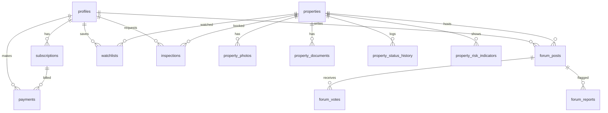

# Database Schema and Data Dictionary

## 5.1 Enums

`user_role` (user, admin) · `subscription_tier` (essential, premium) · `subscription_status` (pending, active, past_due, cancelled, expired) · `payment_status` (created, authorized, captured, failed, refunded) · `property_type` (residential_flat, residential_house, commercial, plot, other) · `listing_status` (draft, pending_verification, teaser, member_available, auction_approaching, auction_completed, withdrawn_postponed, recheck_required) · `possession_status` (vacant, occupied, third_party, unknown) · `evidence_label` (verified_source, advocate_reviewed, first_hand, third_party, pending_verification, unknown) · `risk_indicator` (price_attractiveness, document_completeness, possession, dues, inspection, legal_questions, data_freshness) · `contribution_type` (inspection_experience, document_question, reported_dues, building_condition, valuation, auction_process, advocate_question, other) · `inspection_status` (requested, confirmed, completed, cancelled, declined) · `notification_type` (…) · `simulation_difficulty` (beginner, intermediate, advanced) · `report_status` (open, resolved, dismissed).

## 5.2 Core Tables

**profiles** — `id uuid PK (=auth.users.id)`, `full_name text`, `phone text null`, `role user_role default 'user'`, `gstin text null`, `created_at`, `updated_at`, `deleted_at null`.

**subscriptions** — `id uuid PK`, `user_id FK profiles`, `tier subscription_tier`, `status subscription_status`, `razorpay_subscription_id text unique`, `current_period_start timestamptz`, `current_period_end timestamptz`, `auto_renew bool default true`, `cancelled_at null`, `created_at`, `updated_at`.

**payments** — `id uuid PK`, `user_id FK`, `subscription_id FK null`, `razorpay_payment_id text unique`, `razorpay_order_id text null`, `amount_inr int`, `gst_amount_inr int`, `currency text default 'INR'`, `status payment_status`, `invoice_number text unique null`, `method text null`, `created_at`.

**properties** — `id uuid PK`, `reference_code text unique`, `title text`, `property_type property_type`, `configuration text null`, `description text null`, `carpet_area_sqft numeric null`, `built_up_area_sqft numeric null`, `reserve_price_inr bigint`, `emd_amount_inr bigint null`, `emd_deadline timestamptz null`, `auction_date date null`, `auction_time time null`, `auction_authority text null`, `official_source_ref text null`, `general_location text`, `exact_location text null` *(restricted)*, `building_name text null` *(restricted)*, `society_name text null` *(restricted)*, `possession_status possession_status default 'unknown'`, `possession_source text null`, `reported_dues_inr bigint null`, `dues_verification_status evidence_label default 'unknown'`, `inspection_available bool default false`, `listing_status listing_status default 'draft'`, `published_at null`, `last_verified_at null`, `created_by FK profiles`, `created_at`, `updated_at`, `deleted_at null`.

Indexes: `(listing_status, auction_date)`, `(reference_code)`, `(general_location)`.

**property_photos** — `id`, `property_id FK`, `storage_path text`, `caption text null`, `sort_order int`, `is_public bool default true`, `created_at`.

**property_documents** — `id`, `property_id FK`, `doc_type text`, `storage_path text`, `is_member_accessible bool default true`, `uploaded_by FK`, `created_at`.

**property_status_history** — `id`, `property_id FK`, `from_status`, `to_status`, `changed_by FK`, `note text null`, `created_at`.

**property_risk_indicators** — `id`, `property_id FK`, `indicator risk_indicator`, `evidence_label evidence_label`, `value_text text null`, `note text null`, `updated_by FK`, `updated_at`.

**forum_posts** — `id`, `property_id FK`, `author_id FK`, `parent_id FK null`, `contribution_type contribution_type`, `body text`, `is_helpful_answer bool default false`, `upvote_count int default 0`, `created_at`, `edited_at null`, `deleted_at null`.
Index: `(property_id, created_at)`.

**forum_votes** — `id`, `post_id FK`, `user_id FK`, unique `(post_id, user_id)`.

**forum_follows** — `id`, `user_id FK`, `property_id FK`, unique `(user_id, property_id)`.

**forum_reports** — `id`, `post_id FK`, `reporter_id FK`, `reason text`, `status report_status`, `resolved_by null`, `resolved_at null`, `created_at`.

**watchlists** — `id`, `user_id FK`, `property_id FK`, unique `(user_id, property_id)`, `created_at`.

**inspections** — `id`, `property_id FK`, `user_id FK`, `preferred_dates jsonb`, `status inspection_status`, `notes text null`, `admin_note text null`, `consent_at timestamptz`, `created_at`, `updated_at`.

**advocate_enquiries** — `id`, `user_id FK`, `property_id FK`, `question text`, `status text`, `fee_disclosure jsonb`, `created_at`, `updated_at`.

**notifications** — `id`, `user_id FK`, `type notification_type`, `title`, `body`, `link text null`, `read_at null`, `created_at`. Index `(user_id, read_at)`.

**simulation_sessions** — `id`, `user_id null`, `scenario_key text`, `difficulty`, `budget_inr bigint`, `outcome text`, `final_bid_inr bigint`, `report jsonb`, `created_at`.

**cost_calculations** — `id`, `user_id null`, `property_id null`, `inputs jsonb`, `outputs jsonb`, `created_at`.

**articles** / **quizzes** / **quiz_questions** / **quiz_attempts** / **badges** / **user_badges** / **learning_progress**.

**audit_logs** — `id`, `actor_id null`, `action text`, `entity_type text`, `entity_id text`, `metadata jsonb`, `ip text null`, `created_at`.

**Phase 2 tables:** `advocates`, `legal_reviews`, `drt_records`, `max_bid_plans`, `exit_plans`, `inspection_checklists`.

## 5.3 ERD (core)

## 5.4 Retention

Account data: until deletion + 30 days. Forum posts: retained, anonymised on account deletion. Documents: 12 months after case closure or as legally required. Payments/invoices: 8 years (tax). Audit logs: 24 months. Notifications: 12 months.

---
