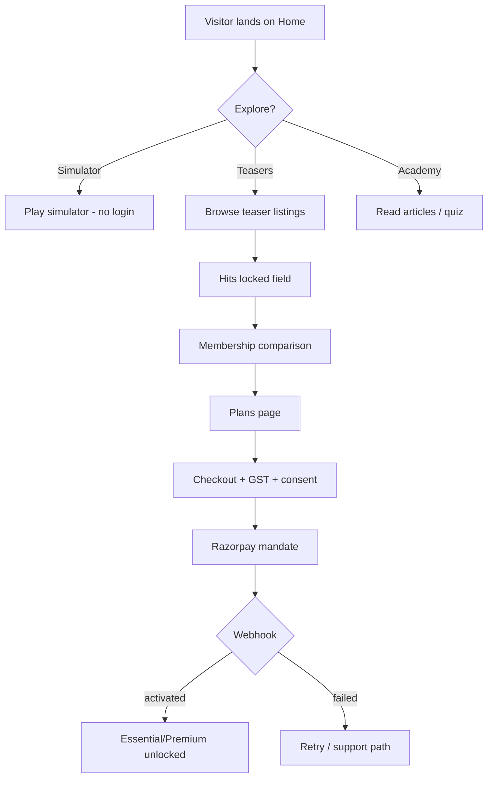
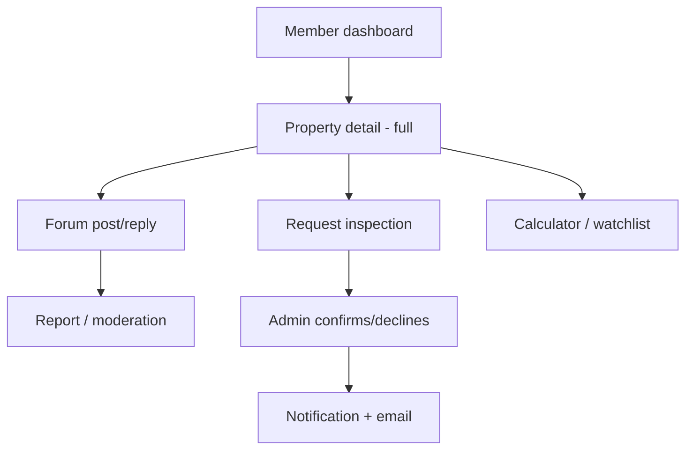
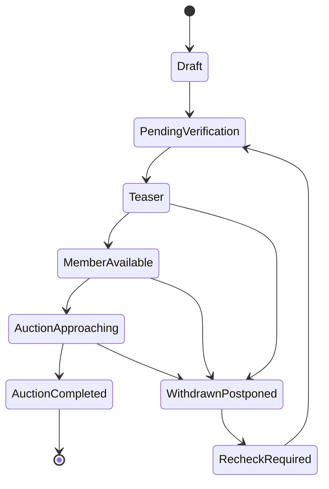
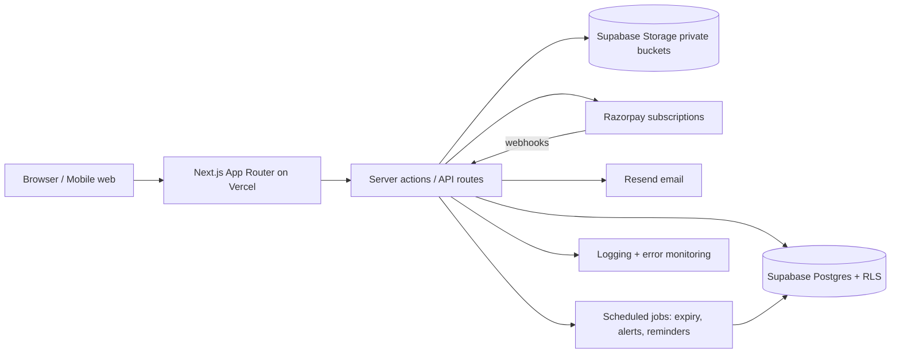
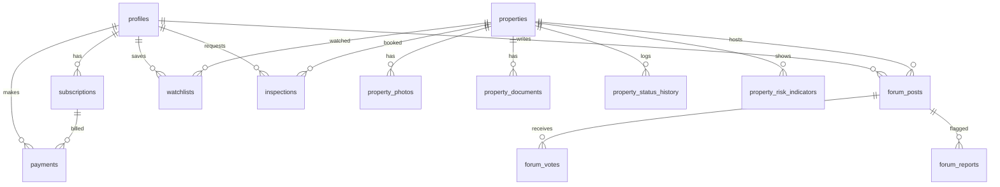

# AuctionIQ — Pre-Development Documentation Pack

**Status:** Draft v1.0 for review
**Basis:** Website Development Specification + approved defaults
**No code will be generated until you approve this pack.**

---

## Approved Defaults (locked)

| Decision | Value |
|---|---|
| Working title | AuctionIQ |
| Stack | Next.js (App Router) + TypeScript + Tailwind; Supabase Postgres; Prisma; Supabase Auth/Storage; Razorpay; Resend; Vercel |
| Tier launch | Essential + Premium launch together |
| MVP inspection | Logged request only (no partner/SmartDoor booking engine) |
| Advocate/DRT | Premium entitlement = enquiry/coordination request; full workspace + DRT dashboard in Phase 2 |
| Billing | Razorpay auto-renewal mandates; no trial; no partial-month refunds |
| Listings | Admin-entered; 8 seeded demo listings; 6 fictional simulator properties; 10 Academy articles; 2 quizzes |
| Notifications | Email + in-platform only |
| Legal entity | Assumed incorporated; GST fields and invoice records in scope |
| Developer model | Vendor brief + internal build guide |

---

# Document 1 — Product Requirements Document (PRD)

## 1.1 Vision and Problem Statement

**Vision.** AuctionIQ is a premium bank-auction property intelligence platform that helps Indian investors *discover the opportunity, understand the risks, and prepare before they bid* — through free education and simulation, and paid verified information, community knowledge and due-diligence coordination.

**Problem.** Bank auction (SARFAESI/DRT) properties in South Mumbai and Navi Mumbai offer price advantages but are opaque: scattered notices, unclear dues, possession uncertainty, document gaps, and no structured peer knowledge. Investors either avoid the category or bid uninformed.

**Product principle.** Free users learn and practise. Paying members discover and evaluate real opportunities. Premium members receive deeper intelligence and defined support services.

**Initial market.** South Mumbai and Navi Mumbai, Maharashtra.

## 1.2 User Roles

| Role | Definition | Commercial state |
|---|---|---|
| Public visitor | Unauthenticated | Free |
| Registered free user | Has account, no active subscription | Free |
| Essential member | Active Essential subscription | ₹850/month + GST |
| Premium member | Active Premium subscription | ₹1,250/month + GST |
| Expired member | Subscription ended/cancelled | Read-only own records |
| Administrator | Operations team | Internal |

## 1.3 Feature List by Phase

### MVP (Phase 1 — Launch)

| # | Feature | Notes |
|---|---|---|
| F1 | Public teaser listings (list + detail) | Photos, reserve price, broad category, general area, generic ref |
| F2 | Membership plans and Razorpay subscription purchase | Auto-renewal mandates |
| F3 | Entitlement engine and expiry handling | Server-enforced |
| F4 | Admin listing management (CRUD + status workflow) | Manual entry |
| F5 | Free virtual auction simulator | 3 difficulty levels, 6 fictional properties |
| F6 | Learning Academy + 2 quizzes + gamification basics | 10 seeded articles, badges, progress |
| F7 | Property-specific discussion forum (paid) | Contribution types, upvotes, helpful answers, reports, moderation |
| F8 | Basic acquisition-cost calculator | Public basic mode; member standard mode; unknown-charge handling |
| F9 | Member dashboard, watchlists, standard alerts | Email + in-platform |
| F10 | Inspection request (logged) | Essential 5/month; Premium unlimited fair-use |
| F11 | Advocate coordination enquiry (Premium) | Request logged, admin workflow, fee disclosure |
| F12 | Policy pages, consent, access controls, audit log | ToS, Privacy, Community, Refund |

### Phase 2 — Premium Intelligence

| # | Feature |
|---|---|
| P1 | Property risk/intelligence dashboard with evidence labels |
| P2 | Property comparison (up to 3) |
| P3 | Maximum-bid planner |
| P4 | Advanced alerts (document availability, EMD deadlines, auction date changes) |
| P5 | Legal-review workspace and advocate credential verification |
| P6 | DRT case/application tracking dashboard |
| P7 | Full inspection workflow, checklist, observations, history |
| P8 | Investment exit planner (Premium) |

### Phase 3 — Deferred

| # | Feature | Condition |
|---|---|---|
| D1 | SmartDoor integration | Partner authorisation, API, commercial terms |
| D2 | Automated data ingestion | Approved sources and permissions only |
| D3 | Document extraction / structured parsing | — |
| D4 | Institutional/professional investor dashboard | — |
| D5 | WhatsApp/SMS alerts | Cost, consent, provider review |
| D6 | Real-time forum (websockets) | Near-real-time acceptable in MVP |

### Explicitly Out of Scope (all phases unless re-approved)

- Public sale-notice repository.
- Real bidding, deposits, or transactions of any kind.
- Any public contact route, WhatsApp link, or property enquiry for free users.
- Pooling investor funds or arranging collective investments.
- Presenting the platform as a bank, auction authority, or legal adviser.
- Labelling any property “legally safe” from an automated score.

## 1.4 User Stories with Acceptance Criteria

### Public / Free

**US-01 — Browse teaser listings**
As a public visitor I can browse teaser listings so I can see what opportunities exist.
- List shows property photos, reserve price, broad category, general area (e.g. “Mumbai”), generic reference (e.g. AQ-MUM-0042).
- Detail shows selected photos, reserve price, broad category, general area, generic reference, auction date if public-safe, and locked-field placeholders.
- Exact locality that would identify the property, building/society name, sale notice, bank contacts, and documents are not present in HTML, JSON, page source, or metadata.
- Attempting `/properties/:id` for a member-only field returns no data server-side.
- Locked fields render a membership comparison CTA — **no** contact shortcut, WhatsApp link, or enquiry form.

**US-02 — Use simulator without paying**
As a public visitor I can run the full simulator and see results.
- No login required for simulator.
- All three difficulties available.
- Budget ceiling enforced; over-budget bid rejected with explanation.
- Post-game report shows decisions, virtual cost breakdown, and a clear “educational only, no real bids” notice.
- Simulation history persists for logged-in users; anonymous sessions may store locally.

**US-03 — Access learning content**
As a public visitor I can read articles, take quizzes, and earn badges.
- All Academy articles readable without login.
- Quiz results and badges stored for logged-in users only; anonymous users get ephemeral results with sign-up prompt (non-blocking).

**US-04 — View plans and purchase**
As a visitor I can compare plans and subscribe.
- Plans page shows Essential vs Premium feature matrix with exact inclusions and exclusions.
- Advocate fee disclosure (platform coordination vs advocate fees) visible **before** payment.
- Checkout shows price + 18% GST breakdown.
- Unchecked consent required for auto-renewal mandate.
- Successful payment grants tier immediately via webhook; failed payment shows recovery path.

### Essential Member

**US-05 — Unlock listing details**
As an Essential member I can view exact location, building/society name, and member documents.
- Exact location, building/society name, and member-accessible documents visible.
- Sale notices never shown publicly; shown privately only where authorised.
- Downloading a document issues a short-lived signed URL; URL is not indexable and expires.
- Direct API access to another property’s documents without entitlement returns 403.

**US-06 — Post in property forum**
As an Essential member I can discuss a specific property.
- Post requires a contribution type from the defined enum.
- Replies, upvotes, helpful-answer marking work.
- Posts visible only to members with access to that property.
- Report action available; reported post enters admin queue.
- Edit history and timestamps visible.

**US-07 — Request inspection (Essential)**
As an Essential member I can request up to five inspections per month.
- Sixth request in a calendar month is blocked with clear message and counter.
- Request captures property, preferred dates, user details, consent checkbox.
- Status tracked: requested → confirmed/declined → completed/cancelled.
- Confirmation email and in-platform notification sent.

**US-08 — Use calculator and watchlist**
- Standard calculator includes stamp duty, registration, legal, dues, repairs, financing, possession costs.
- Unknown dues display as “Unknown,” never as zero.
- Assumptions panel is always visible/expandable.
- Watchlist add/remove works; alerts for followed properties delivered by email + in-platform.

### Premium Member

**US-09 — Premium entitlements**
- All Essential features included.
- Unlimited inspection requests subject to fair-use flag (rate-limit guard, e.g. >10/month flags for review, does not hard-block).
- Advocate coordination enquiry available with fee disclosure.
- Premium investor sessions listed where scheduled.
- Phase 2 items show as “available soon” only if explicitly labelled; never presented as live.

### Expired Member

**US-10 — Expiry handling**
- On expiry: restricted property fields, documents, forum posting, inspection requests, and calculations for new properties are disabled.
- User retains: account details, payment history, own forum posts (read-only), own inspection history, own saved calculations, membership status.
- Re-subscription restores access without data loss.

### Administrator

**US-11 — Manage listings**
- Create, edit, publish as teaser, move to member-available, withdraw/postpone, mark recheck-required, mark completed.
- Status transitions recorded in history with actor and timestamp.
- Publishing requires all mandatory public fields and at least one public photo.

**US-12 — Moderate forum**
- View reports queue; remove post, warn user, dismiss report, record reason.
- Removed content hidden from members but retained in audit log.
- Appeal workflow: user can appeal; admin records outcome.

**US-13 — Manage subscriptions and access**
- View user subscription state, payment history, grant/revoke access with audit reason.
- Manual grant creates an audited record and does not alter Razorpay state silently.

**US-14 — Manage inspections and advocate enquiries**
- Update inspection status; add internal notes; notify member on status change.
- Advocate enquiry: record request, assign status, disclose fees, never mark “advocate-reviewed” without a real review record.

## 1.5 User Flows (major journeys)







## 1.6 Non-Functional Requirements

| Area | Requirement |
|---|---|
| Performance | LCP < 2.5s on 4G mobile for public pages; teaser list API p95 < 400ms; simulator interaction < 100ms client-side |
| Security | Server-side authorisation on every restricted read; signed URLs for documents; no restricted fields in public API/source/sitemap/cache; rate limiting on auth, forum, inspection, checkout |
| SEO | Public pages indexable; member pages `noindex`; no restricted data in meta/JSON-LD; canonical tags; sitemap excludes member routes |
| Accessibility | WCAG 2.1 AA target: contrast, keyboard nav, focus states, form labels, alt text |
| Mobile | Mobile-first; tested at 360px, 390px, 768px, 1024px, 1440px |
| Backups | Daily automated DB backups, 30-day retention; storage versioning for documents |
| Logging | Structured app logs; audit log for admin and access-sensitive actions; error monitoring with alerting |
| Privacy | DPDP-aligned consent, retention schedule, deletion workflow, grievance contact |
| Availability | 99.5% target MVP; status page optional |

## 1.7 Success Metrics

- Public visitors, simulator starts/completions, Academy completion rate.
- Teaser views → plan views → checkout starts → paid conversions.
- Free-to-paid conversion; Essential→Premium upgrades.
- MRR, retention, cancellations, churn reason.
- Forum participation, helpful answers per active member.
- Inspection requests and completion rate.
- Legal/advocate enquiry volume (Premium).
- Cost per acquired paid member.

---

# Document 2 — Functional Specification

## 2.1 Listing Visibility Rules

| Field | Public teaser | Member | Admin |
|---|---|---|---|
| Property photos (public set) | Yes | Yes | Yes |
| Reserve price | Yes | Yes | Yes |
| Broad category | Yes | Yes | Yes |
| General area (“Mumbai”, non-identifying) | Yes | Yes | Yes |
| Generic reference | Yes | Yes | Yes |
| Auction date | Yes if source-confirmed public-safe | Yes | Yes |
| Exact location | No | Yes | Yes |
| Building/society name | No | Yes | Yes |
| EMD amount/deadline | No | Yes | Yes |
| Auction authority/source ref | No | Yes | Yes |
| Possession info + source | No | Yes | Yes |
| Documents | No | Yes (authorised) | Yes |
| Reported dues + verification | No | Yes | Yes |
| Sale notice | Never public | Private, authorised only | Yes |
| Internal notes | No | No | Yes |

**Hard rules.**
- Public API responses must not include restricted keys at all (not null-masked with real values in source).
- Server-side field projection per role; no client-side filtering of a full payload.
- Member routes and document URLs excluded from sitemap and set `noindex`.

## 2.2 Listing Status Workflow

| Transition | Actor | Preconditions | Side effects |
|---|---|---|---|
| Draft → Pending verification | Admin | Mandatory fields present | — |
| Pending verification → Teaser | Admin | Public fields + ≥1 public photo | Published timestamp; appears publicly |
| Teaser → Member available | Admin | Exact location, building, member docs, dues fields | Member alert (matching watchlists) |
| Member available → Auction approaching | System/Admin | Auction date ≤ 14 days | Alert (auction date) |
| Any → Withdrawn/Postponed | Admin | Reason required | Members notified; removed from active lists |
| Withdrawn → Recheck required | Admin | — | Flag visible to members as “requires recheck” |
| Recheck → Pending verification | Admin | — | — |
| Auction approaching → Completed | Admin/System | Date passed + confirmed | Read-only; retained for history |

Every transition writes `property_status_history`.

## 2.3 Simulator Rules

- Session: select fictional property, difficulty, budget.
- Bid increments fixed per difficulty; timer configurable (default 120s beginner, 90s intermediate, 60s advanced).
- Bid rejected if `bid > budget` or `bid <= current_highest`; message explains rule.
- Competing bidders are deterministic pseudo-agents with difficulty-scaled aggressiveness.
- Outcome: win/lose; report includes virtual acquisition cost breakdown (bid, stamp duty estimate, fees, dues estimate, repairs, buffer), decision notes, and “educational only” banner.
- No real payment, deposit, or external call.

## 2.4 Calculator Rules

Inputs: bid amount, stamp duty %, registration, legal/professional fees, society dues, municipal dues, repairs, financing cost, possession costs, other costs.

- Unknown inputs must be flagged “Unknown”; totals show “Total known costs” and “Unknown items: n” separately.
- Assumption panel lists every rate and source (e.g. “Stamp duty 5% + 1% registration — Maharashtra default, editable”).
- Outputs: estimated total acquisition cost, cost/sqft (if area present), optimistic/expected/high scenarios, cash required, rental yield (if rent input), resale scenario (if value input).
- Maximum-bid planner (Phase 2, Premium): ceiling from budget, costs, renovation, target return, expected rent/resale, financing; warning when bid exceeds budget or target return.

## 2.5 Forum Rules

- One thread page per `property_id`; posts grouped by contribution type filter.
- Contribution types: inspection experience, document question, reported dues, building condition, valuation/comparables, auction process, advocate question, other.
- Upvote once per user per post; author cannot mark own reply as helpful answer (admin can override).
- Edit window: 15 minutes, then edit recorded in history (visible).
- Report reasons: misinformation, personal data, impersonation, spam, unauthorised document sharing, other.
- Moderation actions: dismiss, remove (soft), warn, suspend (admin), record reason.
- Badges: Active Member, Helpful Contributor, Inspection Contributor, Verified Professional (only after credential record exists).

## 2.6 Inspection Request Rules (MVP — logged)

- Essential: max 5 requests per calendar month; counter shown; server-enforced.
- Premium: unlimited with fair-use flag at >10/month for admin review (no hard block).
- Fields: property, preferred dates (1–3), full name, phone, consent checkbox (inspection consent), notes.
- Statuses: requested → confirmed / declined → completed / cancelled.
- Notifications: request received, status change, reminder 24h before confirmed date (email + in-app).

## 2.7 Advocate Coordination (MVP — enquiry only)

- Premium members submit an enquiry: property, document types available, question, preferred contact, consent.
- Admin records status: received → information requested → assigned → closed.
- Fee disclosure shown: platform coordination fee and separate advocate fees (advocates bill directly unless stated).
- `advocate_reviewed` evidence label can only be set when a review record exists with advocate, date, and scope.

## 2.8 Subscription and Entitlement Rules

- States: `pending → active → past_due → cancelled → expired`.
- Active if `current_period_end > now` and status active; 3-day grace for `past_due`, then downgrade.
- Webhooks: `subscription.activated`, `subscription.charged`, `subscription.cancelled`, `subscription.halted`, `payment.captured`, `payment.failed`, `refund.created`.
- Idempotency by event id; webhook signature verified.
- Expiry job runs hourly; on expiry: downgrade role to free, disable paid features, preserve own records.
- Manual admin grant: audited, does not silently modify Razorpay subscription.

## 2.9 Notification Catalogue

| Event | Channel | Recipients |
|---|---|---|
| Welcome / verify email | Email | User |
| Payment success / invoice | Email + in-app | User |
| Payment failed | Email + in-app | User |
| Subscription expiring in 3 days | Email + in-app | User |
| Subscription expired | Email + in-app | User |
| New matching listing (watchlist) | Email + in-app | Members |
| Auction date changed (confirmed) | Email + in-app | Followers |
| EMD/payment deadline approaching | Email + in-app | Members |
| New document available | Email + in-app | Members with access |
| Forum reply / followed thread | In-app + email digest | Members |
| Inspection status change | Email + in-app | Requesting member |
| Advocate enquiry status | Email + in-app | Premium member |
| Report outcome | In-app | Reporter |

## 2.10 Field Validation (selected)

| Field | Rule |
|---|---|
| Email | RFC-ish, normalised lowercase, unique |
| Password | Min 10 chars, check against breach list (Supabase) |
| Phone | E.164-ish Indian format, optional OTP later |
| Reserve price | Positive integer, INR, ≤ ₹100 crore |
| Carpet area | Positive decimal, ≤ 100,000 sqft |
| Auction date | Future or recent past (≤ 90 days) for completion |
| Preferred inspection dates | 1–3 dates, each ≥ tomorrow, ≤ 60 days |
| Forum post body | 10–10,000 chars, sanitised, no `<script>` |
| Contribution type | Enum only |
| GSTIN | 15-char pattern, optional |
| Property reference | Immutable, unique, system-generated |

## 2.11 States (UI)

For each list/table: loading skeleton, empty state with next action, error with retry, permission-denied state (membership CTA or access message), expired state.

---

# Document 3 — Access Control Matrix

## 3.1 Role Capability Summary

| Capability | Public | Free registered | Essential | Premium | Expired | Admin |
|---|---|---|---|---|---|---|
| View teaser listings | ✅ | ✅ | ✅ | ✅ | ✅ | ✅ |
| View exact location/building | ❌ | ❌ | ✅ | ✅ | ❌ | ✅ |
| View member documents | ❌ | ❌ | ✅ | ✅ | ❌ | ✅ |
| Contact team about a property | ❌ | ❌ | ✅ | ✅ | ❌ | ✅ |
| General support contact | ✅ | ✅ | ✅ | ✅ | ✅ | ✅ |
| Forum read | ❌ | ❌ | ✅ | ✅ | Own posts only | ✅ |
| Forum post/reply/vote | ❌ | ❌ | ✅ | ✅ | ❌ | ✅ |
| Simulator | ✅ | ✅ | ✅ | ✅ | ✅ | ✅ |
| Academy/quizzes | ✅ | ✅ | ✅ | ✅ | ✅ | ✅ |
| Basic calculator | ✅ | ✅ | ✅ | ✅ | ✅ | ✅ |
| Standard/advanced calculator | ❌ | ❌ | ✅ | ✅ | ❌ | ✅ |
| Watchlist/alerts | ❌ | ❌ | ✅ | ✅ | Read-only | ✅ |
| Inspection request | ❌ | ❌ | 5/mo | Fair-use | ❌ | Manage |
| Advocate enquiry | ❌ | ❌ | ❌ | ✅ | ❌ | ✅ |
| Risk dashboard / comparison / max-bid / exit planner | ❌ | ❌ | ❌ | Phase 2 | ❌ | ✅ |

## 3.2 Route-Level Rules

| Route | Public | Free | Essential | Premium | Expired | Admin |
|---|---|---|---|---|---|---|
| `/` `/explore` `/simulator` `/academy` `/plans` `/about` `/legal/*` | ✅ | ✅ | ✅ | ✅ | ✅ | ✅ |
| `/properties/[ref]` | teaser projection | teaser | full | full | teaser | full |
| `/properties/[ref]/documents/[id]` | 403 | 403 | signed URL | signed URL | 403 | ✅ |
| `/forum/[propertyRef]` | 403 | 403 | ✅ | ✅ | own posts | ✅ |
| `/dashboard/*` | redirect login | ✅ | ✅ | ✅ | read-only own | ✅ |
| `/admin/*` | 403 | 403 | 403 | 403 | 403 | ✅ |
| `/api/properties` | teaser projection | teaser | full | full | teaser | full |

## 3.3 API Enforcement Rules

1. Every API route resolves session → role → entitlement server-side.
2. Response serialisers are **per-role projections**; restricted keys are absent, not null.
3. Object-level checks: document, forum thread, inspection, legal review bound to `user_id` or property entitlement.
4. Public endpoints never accept `property_id` to return restricted fields; the `contact` endpoint requires paid entitlement and validates property access.
5. Rate limits: auth 5/min/IP; forum 10/min/user; inspection 5/day/user; checkout 5/hour/user.
6. No restricted data in sitemap, JSON-LD, OG tags, `robots`-indexed pages, or error messages.
7. Signed URLs: 5-minute expiry, single-use where practical, no directory listing.
8. Admin routes require role + audit log on every write.

## 3.4 Database-Level Enforcement

- Row-level security on `property_documents`, `forum_posts`, `inspections`, `legal_reviews`, `drt_records`, `payments`, `notifications`.
- Service role only for admin/server jobs; never exposed to client.
- Sensitive columns (`exact_location`, `building_name`, `sale_notice_path`) never selected by public projection functions.

---

# Document 4 — Technical Architecture Document

## 4.1 Architecture Overview



## 4.2 Folder Structure (proposed)

```
app/
  (public)/            # home, explore, simulator, academy, plans, about, legal
  (member)/            # dashboard, properties full, forum, tools
  (admin)/admin/       # admin panel
  api/                 # route handlers
components/
  ui/                  # design system primitives
  property/ forum/ tools/ dashboard/ admin/
lib/
  auth/ entitlements/ projections/ validation/ payments/ notifications/ audit/
prisma/
  schema.prisma migrations/
jobs/                  # scheduled tasks
tests/                 # unit, integration, e2e
```

## 4.3 Stack and Third Parties

| Layer | Choice | Purpose |
|---|---|---|
| Frontend | Next.js App Router, TypeScript, Tailwind | SSR/SEO public pages, member app |
| Backend | Next.js route handlers + server actions | API + server-side authorisation |
| DB | Supabase Postgres | Primary data store, RLS |
| ORM | Prisma | Schema, migrations, typed access |
| Auth | Supabase Auth | Email/password, sessions, JWT |
| Storage | Supabase Storage (private) | Property photos, documents, inspection photos |
| Payments | Razorpay Subscriptions | Mandates, invoices, webhooks |
| Email | Resend | Transactional + alert emails |
| Hosting | Vercel | App hosting, cron |
| Monitoring | Sentry + Vercel logs + DB alerts | Errors, performance |
| Analytics | Vercel Analytics / Plausible | Funnel + metrics |

## 4.4 Auth and Entitlement Model

- JWT contains `sub`, `role` (`user`/`admin`), and is refreshed; tier is **not** trusted from JWT alone — resolved server-side from `subscriptions`.
- Entitlement resolver: `getEntitlement(userId) → { tier, active, expiresAt, isAdmin }`, cached ≤ 60s.
- All member checks call the resolver server-side.

## 4.5 Payments Flow

1. User selects plan → server creates/reuses Razorpay plan → creates subscription → returns `subscription_id`.
2. Client completes mandate via Razorpay Checkout.
3. Webhooks update `subscriptions` and `payments`; entitlement cache invalidated.
4. Invoice record created on `payment.captured` with GST breakdown.
5. Refund events recorded; no silent state changes.

## 4.6 Secrets and Environments

- `.env.local` (dev), Vercel env vars (preview/prod), Supabase project secrets.
- Required: `DATABASE_URL`, `SUPABASE_URL`, `SUPABASE_ANON_KEY`, `SUPABASE_SERVICE_ROLE_KEY`, `RAZORPAY_KEY_ID`, `RAZORPAY_KEY_SECRET`, `RAZORPAY_WEBHOOK_SECRET`, `RESEND_API_KEY`, `NEXT_PUBLIC_APP_URL`, `CRON_SECRET`.
- Service role key never shipped to client; only server runtime.

## 4.7 Staging and Production

- Environments: `local`, `preview` (per PR), `staging`, `production`.
- Separate Supabase projects and Razorpay test/live keys.
- Staging seeded with demo listings and test users.
- Migrations run via CI; production migrations require manual approval.

## 4.8 Security, Backup, Monitoring

- RLS everywhere; least privilege; signed URLs; CSRF protection on mutations; input sanitisation; rate limiting; audit log.
- Daily DB backups (30 days), storage versioning, quarterly restore test.
- Error monitoring with alert routing; slow query logging; webhook failure alerts; cron failure alerts.

---

# Document 5 — Database Schema and Data Dictionary

## 5.1 Enums

`user_role` (user, admin) · `subscription_tier` (essential, premium) · `subscription_status` (pending, active, past_due, cancelled, expired) · `payment_status` (created, authorized, captured, failed, refunded) · `property_type` (residential_flat, residential_house, commercial, plot, other) · `listing_status` (draft, pending_verification, teaser, member_available, auction_approaching, auction_completed, withdrawn_postponed, recheck_required) · `possession_status` (vacant, occupied, third_party, unknown) · `evidence_label` (verified_source, advocate_reviewed, first_hand, third_party, pending_verification, unknown) · `risk_indicator` (price_attractiveness, document_completeness, possession, dues, inspection, legal_questions, data_freshness) · `contribution_type` (inspection_experience, document_question, reported_dues, building_condition, valuation, auction_process, advocate_question, other) · `inspection_status` (requested, confirmed, completed, cancelled, declined) · `notification_type` (…) · `simulation_difficulty` (beginner, intermediate, advanced) · `report_status` (open, resolved, dismissed).

## 5.2 Core Tables

**profiles** — `id uuid PK (=auth.users.id)`, `full_name text`, `phone text null`, `role user_role default 'user'`, `gstin text null`, `created_at`, `updated_at`, `deleted_at null`.

**subscriptions** — `id uuid PK`, `user_id FK profiles`, `tier subscription_tier`, `status subscription_status`, `razorpay_subscription_id text unique`, `current_period_start timestamptz`, `current_period_end timestamptz`, `auto_renew bool default true`, `cancelled_at null`, `created_at`, `updated_at`.

**payments** — `id uuid PK`, `user_id FK`, `subscription_id FK null`, `razorpay_payment_id text unique`, `razorpay_order_id text null`, `amount_inr int`, `gst_amount_inr int`, `currency text default 'INR'`, `status payment_status`, `invoice_number text unique null`, `method text null`, `created_at`.

**properties** — `id uuid PK`, `reference_code text unique`, `title text`, `property_type property_type`, `configuration text null`, `description text null`, `carpet_area_sqft numeric null`, `built_up_area_sqft numeric null`, `reserve_price_inr bigint`, `emd_amount_inr bigint null`, `emd_deadline timestamptz null`, `auction_date date null`, `auction_time time null`, `auction_authority text null`, `official_source_ref text null`, `general_location text`, `exact_location text null` *(restricted)*, `building_name text null` *(restricted)*, `society_name text null` *(restricted)*, `possession_status possession_status default 'unknown'`, `possession_source text null`, `reported_dues_inr bigint null`, `dues_verification_status evidence_label default 'unknown'`, `inspection_available bool default false`, `listing_status listing_status default 'draft'`, `published_at null`, `last_verified_at null`, `created_by FK profiles`, `created_at`, `updated_at`, `deleted_at null`.

Indexes: `(listing_status, auction_date)`, `(reference_code)`, `(general_location)`.

**property_photos** — `id`, `property_id FK`, `storage_path text`, `caption text null`, `sort_order int`, `is_public bool default true`, `created_at`.

**property_documents** — `id`, `property_id FK`, `doc_type text`, `storage_path text`, `is_member_accessible bool default true`, `uploaded_by FK`, `created_at`.

**property_status_history** — `id`, `property_id FK`, `from_status`, `to_status`, `changed_by FK`, `note text null`, `created_at`.

**property_risk_indicators** — `id`, `property_id FK`, `indicator risk_indicator`, `evidence_label evidence_label`, `value_text text null`, `note text null`, `updated_by FK`, `updated_at`.

**forum_posts** — `id`, `property_id FK`, `author_id FK`, `parent_id FK null`, `contribution_type contribution_type`, `body text`, `is_helpful_answer bool default false`, `upvote_count int default 0`, `created_at`, `edited_at null`, `deleted_at null`.
Index: `(property_id, created_at)`.

**forum_votes** — `id`, `post_id FK`, `user_id FK`, unique `(post_id, user_id)`.

**forum_follows** — `id`, `user_id FK`, `property_id FK`, unique `(user_id, property_id)`.

**forum_reports** — `id`, `post_id FK`, `reporter_id FK`, `reason text`, `status report_status`, `resolved_by null`, `resolved_at null`, `created_at`.

**watchlists** — `id`, `user_id FK`, `property_id FK`, unique `(user_id, property_id)`, `created_at`.

**inspections** — `id`, `property_id FK`, `user_id FK`, `preferred_dates jsonb`, `status inspection_status`, `notes text null`, `admin_note text null`, `consent_at timestamptz`, `created_at`, `updated_at`.

**advocate_enquiries** — `id`, `user_id FK`, `property_id FK`, `question text`, `status text`, `fee_disclosure jsonb`, `created_at`, `updated_at`.

**notifications** — `id`, `user_id FK`, `type notification_type`, `title`, `body`, `link text null`, `read_at null`, `created_at`. Index `(user_id, read_at)`.

**simulation_sessions** — `id`, `user_id null`, `scenario_key text`, `difficulty`, `budget_inr bigint`, `outcome text`, `final_bid_inr bigint`, `report jsonb`, `created_at`.

**cost_calculations** — `id`, `user_id null`, `property_id null`, `inputs jsonb`, `outputs jsonb`, `created_at`.

**articles** / **quizzes** / **quiz_questions** / **quiz_attempts** / **badges** / **user_badges** / **learning_progress**.

**audit_logs** — `id`, `actor_id null`, `action text`, `entity_type text`, `entity_id text`, `metadata jsonb`, `ip text null`, `created_at`.

**Phase 2 tables:** `advocates`, `legal_reviews`, `drt_records`, `max_bid_plans`, `exit_plans`, `inspection_checklists`.

## 5.3 ERD (core)



## 5.4 Retention

Account data: until deletion + 30 days. Forum posts: retained, anonymised on account deletion. Documents: 12 months after case closure or as legally required. Payments/invoices: 8 years (tax). Audit logs: 24 months. Notifications: 12 months.

---

# Document 6 — API Specification

## 6.1 Conventions

- Base: `/api`. JSON. Auth via Supabase session cookie/Bearer.
- Errors: `400` validation, `401` unauthenticated, `403` forbidden, `404`, `409` conflict, `429` rate limit, `500`.
- Response envelope: `{ data, error: { code, message, fields? } }`.
- **Rule:** restricted fields are never included in any public/free response payload.

## 6.2 Endpoint List (selected)

| Method | Path | Auth | Role | Purpose |
|---|---|---|---|---|
| GET | `/api/properties` | optional | any | List; projection by role |
| GET | `/api/properties/[ref]` | optional | any | Detail; projection by role |
| GET | `/api/properties/[ref]/documents/[id]` | ✅ | paid | Signed URL (short-lived) |
| GET | `/api/properties/[ref]/posts` | ✅ | paid | Forum posts |
| POST | `/api/properties/[ref]/posts` | ✅ | paid | Create post |
| POST | `/api/posts/[id]/vote` | ✅ | paid | Upvote |
| POST | `/api/posts/[id]/helpful` | ✅ | paid | Mark helpful |
| POST | `/api/posts/[id]/report` | ✅ | paid | Report |
| POST | `/api/watchlist` | ✅ | paid | Add |
| DELETE | `/api/watchlist/[propertyId]` | ✅ | paid | Remove |
| POST | `/api/inspections` | ✅ | paid | Request (quota enforced) |
| GET | `/api/inspections` | ✅ | own/admin | List |
| POST | `/api/advocate-enquiries` | ✅ | premium | Enquiry |
| POST | `/api/simulations` | optional | any | Save session |
| POST | `/api/calculations/cost` | optional | any | Compute + save |
| GET | `/api/notifications` | ✅ | own | List |
| POST | `/api/notifications/[id]/read` | ✅ | own | Mark read |
| POST | `/api/checkout/subscription` | ✅ | any | Create Razorpay subscription |
| POST | `/api/webhooks/razorpay` | signature | — | Payment events |
| GET | `/api/me` | ✅ | own | Profile + entitlement |
| Admin | `/api/admin/properties` (CRUD), `/api/admin/properties/[id]/status`, `/api/admin/reports`, `/api/admin/inspections`, `/api/admin/users/[id]/subscription` | ✅ | admin | Management |

## 6.3 Payment Webhook Flow

1. Verify `X-Razorpay-Signature` with webhook secret.
2. Idempotency: store `event.id`; ignore duplicates.
3. Update `subscriptions` / `payments` / invoice in a transaction.
4. Invalidate entitlement cache; enqueue notification.
5. Return `200`; on failure log and return `500` for retry.

## 6.4 Document Access Flow

`GET /api/properties/[ref]/documents/[id]` → verify session → verify paid entitlement → verify property access → check document `is_member_accessible` → generate signed URL (5 min) → log access → return `{ url, expiresAt }`. Direct storage paths never exposed.

## 6.5 Public API Leakage Rules

- `GET /api/properties` and `/api/properties/[ref]` use explicit select lists per role.
- No `include: true` full-model serialisation.
- Tests assert restricted keys are absent (not null) for free/public.
- No property-specific contact endpoint accessible to free users.

---

# Document 7 — UI/UX Wireframe Plan

## 7.1 Navigation

- Public header: Home · Explore Auctions · Simulator · Academy · Plans · About · Login/Sign up.
- Member header: Dashboard · Explore · Forum · Tools · Watchlist · Notifications · Account.
- Admin: separate `/admin` shell with sidebar (Listings, Users, Payments, Reports, Inspections, Enquiries, Content, Audit).
- Footer: policies (Terms, Privacy, Refund, Community), grievance contact, company details.

## 7.2 Page-by-Page (18 required + admin)

| Page | Key wireframe notes |
|---|---|
| Home | Hero headline; simulator preview card; latest teasers (3); “How auctions work” strip; tools preview; approved sample community content; advocate/due-diligence section; plan comparison; FAQ; footer |
| Explore Auctions | Filter bar (type, reserve range, area, status); teaser cards with lock indicators; pagination; empty state |
| Property Detail | Gallery; public facts; locked panels with plan comparison CTA; member view adds exact location, documents, forum entry, inspection button |
| Membership Plans | Side-by-side matrix; inclusions/exclusions; advocate fee disclosure; GST note; consent at checkout |
| Simulator | Setup → bidding screen (timer, current bid, budget bar) → result/report; difficulty selector; educational banner persistent |
| Learning Academy | Article list, reading view, progress; video embeds; FAQ accordion |
| Quizzes & Challenges | Quiz runner, results, badges, leaderboard (optional) |
| Property Comparison | Up to 3 columns; difference highlighting; locked rows prompt upgrade |
| Investor Community | Property forum page; type filters; post composer; helpful answers; report |
| Property Intelligence Tools | Calculator, max-bid planner (Premium/Phase 2), assumptions panel |
| Advocate & Due-Diligence | Service description, scope, fee disclosure, enquiry form (Premium) |
| User Dashboard | Cards: saved properties, threads, enquiries, inspections, documents, dates, calculations, simulation history, membership |
| About / Contact & Support | General support only; no property enquiry for free users |
| Legal pages | Static, versioned |

## 7.3 States

Loading skeletons; empty states with next action; locked state (blur + CTA, no data in DOM); error with retry; expired-state banner with renewal CTA; permission-denied page.

## 7.4 Design System

- Colours: ivory `#FAF8F3`, charcoal `#1F1F1F`, deep navy `#0F2740`, gold `#B08D57`, success/warn/error restrained.
- Typography: serif display for headings, clean sans for body; 8px spacing scale.
- Components: buttons (primary navy, secondary outline, gold accent), forms with inline validation, cards, tables, tabs, badges, modals (no intrusive pop-ups), toasts.
- Accessibility: AA contrast, visible focus, labelled inputs, alt text.

---

# Document 8 — Test Plan and Acceptance Criteria

## 8.1 Functional Tests (per feature)

Simulator (budget enforcement, outcomes, report), Academy (progress, quiz scoring), teaser (projection), checkout (success/failure), forum (post/reply/vote/helpful/report), calculator (known/unknown handling), watchlist alerts, inspection quota, advocate enquiry, dashboard, notifications.

## 8.2 Permission and Leak Tests (must pass)

| # | Test | Expected |
|---|---|---|
| L1 | Free user GET `/api/properties/[ref]` | Restricted keys absent |
| L2 | Free user direct document URL | 403 |
| L3 | Free user forum route | 403 |
| L4 | Expired member document access | 403 |
| L5 | Public page source / JSON-LD / sitemap | No restricted data |
| L6 | Cached/OG metadata | No restricted data |
| L7 | IDOR: another user’s inspection/report | 403 |
| L8 | Admin route as member | 403 |
| L9 | Contact endpoint with property_id as free user | 403 |
| L10 | Signed URL after expiry | 403 |

## 8.3 Payments and Subscription Tests

- Successful mandate → tier active; invoice with GST.
- Failed payment → no entitlement; retry path.
- Cancellation at period end → access until end; then expired.
- Webhook replay idempotent.
- Manual admin grant audited; revoke restores.
- Refund recorded; access adjusted per policy.
- Expiry job downgrades correctly and preserves own records.

## 8.4 Admin Tests

Listing CRUD; status transitions and history; publish validation; moderation actions + audit; inspection status; advocate enquiry; subscription view; audit log writes.

## 8.5 Non-Functional Tests

Mobile at 360/390/768/1024/1440; Chrome/Safari/Firefox/Edge current; Lighthouse ≥ 85 perf/SEO on public pages; accessibility audit; load test teaser list; security headers; dependency audit; backup restore drill.

## 8.6 Definition of Done (each feature)

Coded · unit + integration tests · permission test where relevant · staging demo · documentation updated · accessibility checked · no restricted data leak · acceptance criteria met · approved by you.

## 8.7 Launch Acceptance (from spec §18)

All 15 criteria must pass, including free simulator access, teaser-only public view, no restricted data via URL/API, correct tier unlock, expiry handling, forum participation, moderation, consistent calculator, admin listing lifecycle, private documents, verification indicators, responsive layouts, tested privacy/security/backup, documentation + credentials delivered, no mock presented as live.

---

# Document 9 — Project Plan

## 9.1 Phases and Milestones

| Milestone | Scope | Deliverable | Payment gate |
|---|---|---|---|
| M0 | Approve this pack; legal docs drafted; Supabase/Razorpay accounts; repo + staging | Signed-off docs, staging URL | — |
| M1 | Schema, auth, entitlements, design system, public shell | Working staging, migrations | Demo + tests |
| M2 | Teaser listings + admin listing CRUD + status workflow | Admin + public listings | Access leak tests pass |
| M3 | Simulator + Academy + quizzes + badges | Free experience live | Functional tests |
| M4 | Checkout + webhooks + subscription lifecycle + invoices | Paid tiers working | Payment tests |
| M5 | Member property detail + documents + forum + moderation | Core paid value | Permission tests |
| M6 | Calculator + watchlist + alerts + dashboard + inspection logging | Member tools | Acceptance tests |
| M7 | Advocate enquiry (Premium) + policy pages + audit + hardening | Launch candidate | Full launch checklist |
| M8 | Production launch + handover | Docs, admin guide, credentials | Final sign-off |

Phase 2 milestones (P1–P8) quoted separately.

## 9.2 Dependencies and Risks

| Risk | Mitigation |
|---|---|
| Razorpay onboarding delay | Start KYC early; test-mode build first |
| Legal docs not ready | Draft in M0; block public launch, not build |
| Scope creep into Phase 2 | Explicit deferral list enforced in M-scope |
| Document/data leakage | Access matrix + automated leak tests as gate |
| Advocate/DRT overclaiming | Enquiry-only in MVP; evidence labels enforced |
| Budget pressure | Milestone gating; protected reserve untouched for non-essentials |

## 9.3 Build Order

Foundations → public shell → listings/admin → free engagement → payments → paid core → tools → hardening → launch.

## 9.4 Pre-Production Checklist

- All 15 launch acceptance criteria pass.
- Leak tests pass in production config.
- Legal pages published and versioned.
- Grievance contact live.
- Backups + restore tested.
- Monitoring/alerts live.
- Admin guide + credentials handed over.
- No mock integrations presented as live.
- SmartDoor/DRT/Phase 2 items labelled “coming soon” or hidden.

---

# Final Review Checklist (for your approval)

- [ ] Working name “AuctionIQ” acceptable.
- [ ] Stack (Next.js + Supabase + Prisma + Razorpay + Resend + Vercel) approved.
- [ ] Tier launch together; inspection = logged request only; advocate/DRT enquiry-only in MVP.
- [ ] Auto-renewal, no trial, no partial-month refunds approved.
- [ ] Seeded content (8 listings, 6 simulator scenarios, 10 articles, 2 quizzes) approved.
- [ ] Email + in-platform notifications only approved.
- [ ] GST invoicing in scope approved.
- [ ] Access Control Matrix (Doc 3) approved — especially no public contact route for real listings.
- [ ] Database schema and enums approved.
- [ ] API leakage rule approved as a hard gate.
- [ ] Phase 2/deferred list approved.
- [ ] Milestone/payment gates approved.
- [ ] You will supply: legal entity details, GSTIN, grievance officer, brand logo (or confirm placeholders).

# Assumptions Made

1. Legal entity is incorporated; GSTIN available before production.
2. Razorpay approves the subscription use case for property information services.
3. No existing property database; admin entry + seeded demo data.
4. You will provide brand logo; design system uses spec’s palette as placeholder.
5. Advocate coordination in MVP is enquiry + admin workflow only; no advocate-client relationship created by the platform.
6. DRT tracking is Phase 2 and will only display records where reliable access exists.
7. SmartDoor is Phase 3 and conditional.
8. Premium “unlimited” inspections are rate-flagged, not hard-blocked.
9. Prices are exclusive of 18% GST, shown at checkout.
10. Near-real-time (polling) forum is acceptable for MVP.

---
